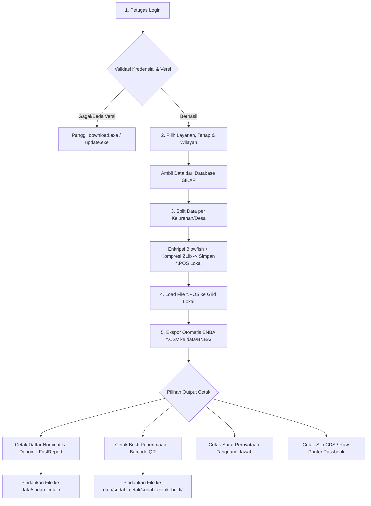

# 01. Ringkasan Eksekutif & Pemahaman Project: CetakDanom (FDPOS)

## 1. Identitas & Latar Belakang Project

| Atribut | Keterangan |
| :--- | :--- |
| **Nama Aplikasi** | FDPOS - Cetak Danom / CetakDataDanom (Fund Distribution PT Pos Indonesia) |
| **Kode / Varian** | `ToolCetakDanom` (Delphi 5), `ToolCetakDanom_QR` (Delphi 7), `downloadParam` (Updater) |
| **Organisasi Pemilik** | PT Pos Indonesia (Persero) |
| **Author / Pengembang** | Nasruddin Mohammad (`nas@posindonesia.co.id`), Jajat Lukman (`jajat.lukman@posindonesia.co.id`), Lukim |
| **Linimasa Pembuatan** | 2004/2005 (Pondasi Middleware NCONN) &rarr; 2014 (FDPOS Cetak Danom) &rarr; 2020 (BST Kemensos & Sembako) &rarr; 2023–2025 (Versi 4.1.9 / 4.2.0, CDS BLT, YAPI) |
| **Versi Aktif di Kode** | Versi `4.1.9` (target pembaruan `4.2.0`, build date `19 November 2025`) |
| **Tujuan Utama** | Pengambilan, pemisahan (*split*), verifikasi, pencetakan Daftar Nominatif (Danom), Bukti Penerimaan Bantuan (Bukti Bayar), Surat Pernyataan Tanggung Jawab, serta ekspor file *By Name By Address* (BNBA) untuk program Bantuan Sosial Pemerintah Republik Indonesia melalui jaringan Kantor Pos di seluruh Indonesia. |

---

## 2. Struktur Repositori & Varian Project

Repositori aplikasi ini terdiri dari 3 sub-proyek utama yang saling terhubung:

```
D:\CetakDanom
│
├── downloadParam/             # Sub-aplikasi Background Downloader / Auto-Updater
│   ├── download.dpr           # Project DPR downloader parameter/aplikasi
│   ├── update.dpr             # Project DPR update binary
│   └── uUpdate.pas / .dfm     # Form download menggunakan Indy HTTP (TIdHTTP) & TGauge
│
├── ToolCetakDanom/            # Varian Aplikasi Basis Delphi 5 (Baseline Legacy)
│   ├── src/
│   │   ├── cetakDanom.dpr     # Entry point aplikasi utama Delphi 5
│   │   ├── Utama.pas / .dfm   # Form utama (alur Danom standar, FastReport 4 + QuickReport)
│   │   ├── ULogin.pas / .dfm  # Form login (berbasis NCONN middleware socket/dll)
│   │   ├── ServerConf.pas     # Form konfigurasi koneksi server (disimpan ke conf.bns)
│   │   ├── Unit1.pas / .dfm   # QuickReport dengan Han-soft 2D Barcode (QR)
│   │   ├── UParam.pas         # Konstanta versi & URL download parameter
│   │   └── UFunction.pas      # Custom RTTI FastScript (ToMD5)
│   ├── lib/                   # Source code & DCU pustaka (NCONN, kbmMemTable, DCPcrypt, dll.)
│   └── dcu/                   # Output kompilasi unit Delphi 5
│
├── ToolCetakDanom_QR/         # Varian Aplikasi Modernisasi Delphi 7 (Versi Lanjutan / Aktif)
│   ├── src/
│   │   ├── cetak.dpr          # Entry point aplikasi 'CetakDataDanom'
│   │   ├── Utama.pas / .dfm   # Form utama (88 MB DFM memuat FR 6.6.12, REST API, RAWPrinter)
│   │   ├── ULogin.pas / .dfm  # Form login (ADOConnection SQL Server langsung ke fd_db_dev_bsm)
│   │   ├── ServerConf.pas     # Form konfigurasi host & socket server
│   │   ├── UParam.pas         # Parameter versi v4.1.9 -> v4.2.0
│   │   ├── UFunction.pas      # Modul RTTI FastReport PascalScript untuk hashing MD5
│   │   ├── uLkJSON.pas        # JSON Parser untuk konsumsi REST API Gateway CDS
│   │   ├── Pernyataan.fr3     # Template FastReport Surat Pernyataan Sembako
│   │   ├── frBuktiTerima.fr3  # Template FastReport Bukti Penerimaan Bansos (QR 2D Barcode)
│   │   └── frDanom.fr3        # Template FastReport Daftar Nominatif standar
│   ├── lib/                   # Komponen pihak ketiga & utilitas jaringan lokal
│   └── dcu/                   # Output DCU Delphi 7
│
└── docs/                      # Dokumentasi Hasil Reverse Engineering & Modernisasi
```

---

## 3. Cakupan Program Bantuan Sosial yang Dilayani

Berdasarkan analisis logika formulir, stored procedure, dan template laporan (*.fr3*), aplikasi ini dirancang khusus untuk menangani distribusi berbagai program bantuan pemerintah:

1. **BST (Bantuan Sosial Tunai - Kemensos RI)**:
   - Nilai bantuan: Rp 600.000 / Rp 300.000 per Keluarga Penerima Manfaat (KPM).
   - Menghasilkan Bukti Terima dengan barcode 2 dimensi (QR Code) yang memuat data NIK, Nama, Alamat KTP, ID Pelanggan, dan nominal bantuan per tahap (*tahap 1, 2, 3*).
2. **Program Sembako / BPNT (Bantuan Pangan Non-Tunai)**:
   - Mencetak formulir Surat Pernyataan Tanggung Jawab Mutlak KPM untuk membelanjakan dana pada 4 unsur bahan pangan (karbohidrat, protein hewani, protein nabati, vitamin/mineral) dengan sanksi pencabutan bantuan jika melanggar.
3. **CDS BLT (Cetak Danom Susulan - Bantuan Langsung Tunai)**:
   - Terintegrasi secara *real-time* via REST API Gateway (WSO2) untuk validasi NIK terhadap database DTKS (Data Terpadu Kesejahteraan Sosial).
   - Menghitung BSU (*Bantuan Subsidi Upah* / Nominal): `KUANTITAS * NOMINAL`.
   - Mendukung pencetakan langsung ke printer slip/passbook menggunakan perintah RAW Printer (ESC/P).
4. **YAPI (Bantuan Anak Yatim Piatu)**:
   - Formulir dan laporan khusus Danom YAPI (`frxReportYapi` & `frxReportDnmYapi`).
5. **Bansos Mandiri / Instansi**:
   - Skema khusus pemisahan data per instansi pemberi kerja atau pemerintah daerah kota/kabupaten.

---

## 4. Pola Kerja & Alur Operasional Utama (Pipeline Data)

Aplikasi memiliki pola kerja berurutan (*sequential batch pipeline*):



---

## 5. Ringkasan Temuan Teknis Kritis

1. **Evolusi Dua Generasi Kode**:
   - `ToolCetakDanom` adalah basis Delphi 5 murni yang berkomunikasi via middleware socket buatan sendiri (`NCONN.pas` + `sockmoddb.dll`) dan menyimpan data biner dataset `kbmMemTable`.
   - `ToolCetakDanom_QR` adalah modifikasi Delphi 7 yang menambahkan integrasi langsung ke Microsoft SQL Server menggunakan ADO/OLE DB, memuat pustaka REST JSON (`uLkJSON`), dan FastReport 6.6.12 dengan QR Code 2D.
2. **Ukuran Form Ekstrem (`Utama.dfm` = 88 MB)**:
   - Pada `ToolCetakDanom_QR`, file form DFM berukuran 88 MB karena berisi 9 objek `TfrxReport` lengkap dengan gambar logo (*logo garuda, logo pos, logo kementerian*), template report, dan konfigurasi visual yang di-*embed* langsung dalam format teks heksadesimal ke dalam DFM.
3. **Mekanisme Keamanan Proprietary**:
   - File konfigurasi server (`conf.bns`) dan file data transaksi (`*.POS` pada versi awal) diamankan menggunakan kombinasi kompresi `ZLib` tingkat maksimal dan enkripsi simetris `Blowfish` (via `DCPcrypt`).
   - Kata sandi petugas di-hash menggunakan algoritma `MD5(UserID + Password)`.
4. **Ketergantungan Hardware Khusus**:
   - Ditemukan implementasi `RAWPrinter.pas` yang mengirim instruksi byte mentah ESC/P langsung ke spooler Windows untuk mencetak slip pada printer dot-matrix (*Epson LQ-300*) dan passbook teller pos (*IBM 9068A*).
5. **Ketergantungan Antar Proses**:
   - `cetak.exe` memiliki pengamanan yang memeriksa apakah proses `cetakDanom.exe` sedang aktif melalui Windows API `CreateToolhelp32Snapshot` (`processExists('cetakDanom.exe')`). Jika tidak ada, aplikasi langsung mematikan dirinya (`Application.Terminate`).

