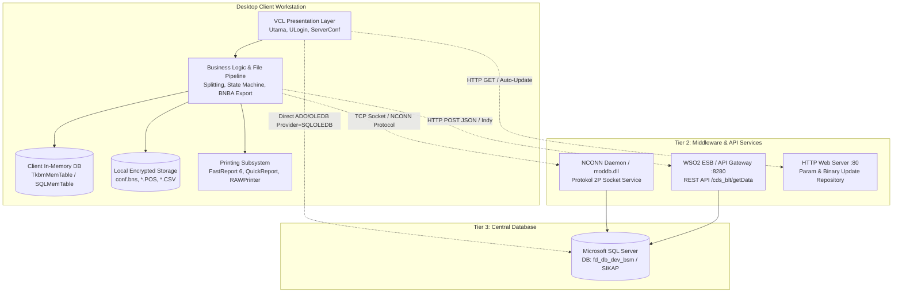
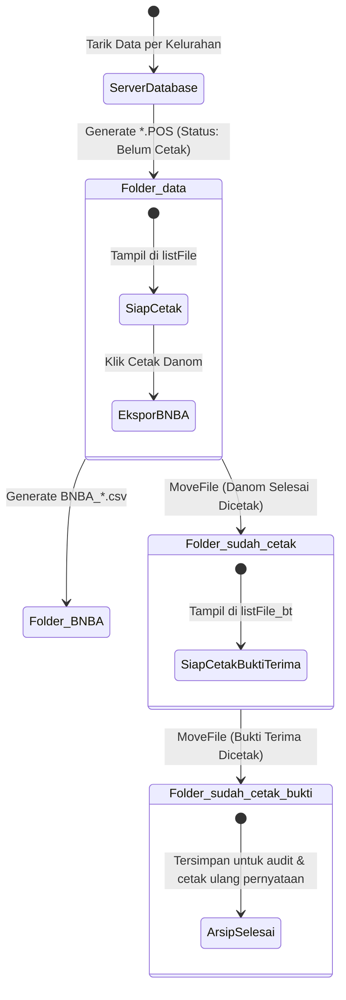

# 02. Identifikasi Arsitektur Aplikasi

## 1. Topologi Arsitektur Global

Aplikasi **CetakDanom (FDPOS)** mengadopsi model arsitektur **Fat-Client Desktop (Win32)** dengan pola hibrida **2-Tier / 3-Tier** yang dirancang untuk mengakomodasi infrastruktur jaringan Kantor Pos (Kprk / Kantor Pos Cabang) yang memiliki variasi kualitas konektivitas (mulai dari jaringan kantor terpusat hingga operasi loket darurat di pelosok/lapangan).



---

## 2. Mode Operasional Ganda (Dual-Mode Architecture)

Aplikasi memiliki mekanisme failover operasional yang diaktifkan melalui UI:

### A. Mode Online (Normal Mode)
- **Karakteristik**: Klien terhubung ke database pusat SQL Server atau middleware socket.
- **Fitur yang Tersedia**:
  - Penarikan daftar wilayah berjenjang: Layanan &rarr; Kabupaten &rarr; Kecamatan &rarr; Kelurahan.
  - Penarikan data massal penerima bansos melalui Stored Procedure `SIKAP_GET_DATA_BANSOSRS`.
  - Pengecekan data real-time via REST API Gateway CDS BLT (`/cds_blt/getData`).
  - Verifikasi versi dan pengunduhan update otomatis.

### B. Mode Offline / Lokal (`Mode Lokal` via Hotkey VK_F5)
- **Karakteristik**: Diaktifkan saat petugas berada di daerah minim sinyal/kantor bayar komunitas.
- **Logika Kode (`ULogin.pas:162-169`)**:
  ```pascal
  if Key = VK_F5 then
    if MessageDlg('PERHATIAN ANDA AKAN PINDAH KE MODE LOKAL !' + CHR(13) +
      'MODE LOKAL HANYA UNTUK PENCETAKAN DATA !' + CHR(13) + 
      'LANJUT KE MODE LOKAL ?', mtConfirmation, [mbYes, mbNo], 0) = mrYes then
    begin
      isLokal := true;
    end;
  ```
- **Fitur yang Tersedia**:
  - Melewati validasi login ke server database.
  - Membaca file `.POS` yang sebelumnya sudah diunduh ke direktori lokal `data/`.
  - Melakukan dekompresi ZLib dan dekripsi Blowfish secara lokal ke memori.
  - Menampilkan data pada `TbvDBGrid` dan melakukan pencetakan Danom, Bukti Terima, dan Surat Pernyataan.

---

## 3. Layering & Komponen Perangkat Lunak

```
┌─────────────────────────────────────────────────────────────┐
│ 1. PRESENTATION LAYER (VCL GUI)                             │
│   - Form Utama (Utama.pas)                                  │
│   - Form Autentikasi (ULogin.pas)                           │
│   - Form Konfigurasi Koneksi (ServerConf.pas)               │
│   - Form Progress Downloader (uUpdate.pas)                  │
│   - Komponen UI Khusus: dxButtons, NxCollection, GPanel     │
├─────────────────────────────────────────────────────────────┤
│ 2. REPORTING & PRINTING LAYER                               │
│   - FastReport 6.6.12 / 4.0 Engine (frxReport, frxDBSet)    │
│   - 2D Barcode (QR Code) Generator untuk Cetak Kuitansi      │
│   - QuickReport Subsystem (Unit1.pas, r.dfm)                │
│   - RAWPrinter Subsystem (Direct ESC/P Win32 Spooler)       │
│   - FastScript PascalScript & Custom RTTI (ToMD5 via UFunction)
├─────────────────────────────────────────────────────────────┤
│ 3. BUSINESS LOGIC & DATA PIPELINE LAYER                     │
│   - Batch Data Extraction & File Splitting by Kelurahan     │
│   - File Lifecycle State Machine (data -> sudah_cetak)      │
│   - BNBA (By Name By Address) CSV Generator                 │
│   - CDS (Cetak Danom Susulan) JSON Processing & BSU Calc    │
├─────────────────────────────────────────────────────────────┤
│ 4. IN-MEMORY DATASET & SERIALIZATION LAYER                  │
│   - TkbmMemTable V5.00 (In-Memory Tabular Store)            │
│   - TkbmBinaryStreamFormat (Binary serialization stream)    │
│   - SQLMemTable (Local embedded SQL engine)                 │
│   - Delimited POS Text Parser (Semicolon CSV format)        │
├─────────────────────────────────────────────────────────────┤
│ 5. MIDDLEWARE, PROTOCOL & SECURITY LAYER                    │
│   - NCONN (Network Abstraction & Dynamic DLL Dispatcher)    │
│   - NCrypt (Blowfish, Twofish, 3DES, RC4, MD5 Hashing)      │
│   - NZip (ZLibEx compression stream zcMax)                  │
│   - NSession (Thread-safe session state tracking)           │
│   - ADO/OLE DB Direct SQL Server Connection (SQLOLEDB.1)    │
│   - Indy 9/10 HTTP Client (TIdHTTP REST & Auto-Update)      │
└─────────────────────────────────────────────────────────────┘
```

---

## 4. Pipeline & State Machine Pengelolaan File Data

Penyimpanan data lokal menggunakan sistem direktori sebagai *state machine* untuk melacak status cetak tanpa memerlukan database lokal berat:



### Konvensi Penamaan File (`Naming Convention`):
File data diberi nama terstruktur yang memuat metadata administratif:
1. **Pola Standar (Delphi 5 / Legacy)**:
   ```
   [KODELAYANAN]_[KODE_SP]_[KABUPATEN]_[KECAMATAN]_[KELURAHAN]_[NOPEND]_[JML_RECORD]_[KODE_HEADER].POS
   Contoh: PU1_SP0_BANDUNG_COBLONG_DAGO_40135_250_0.POS
   ```
2. **Pola Sederhana (ToolCetakDanom_QR)**:
   ```
   [KABUPATEN]_[KELURAHAN]_[KECAMATAN]_[NOPEND]_[JML_RECORD].POS
   Contoh: KOTA BANDUNG_DAGO_COBLONG_40000_150.POS
   ```
3. **Pola Ekspor BNBA**:
   ```
   BNBA_[NAMA_FILE_POS_TANPA_EKSTENSI].csv
   Contoh: data/BNBA/BNBA_KOTA BANDUNG_DAGO_COBLONG_40000_150.csv
   ```

---

## 5. Pola Integrasi Antar-Proses (*Companion / Sidecar Pattern*)

Aplikasi terdiri dari beberapa *executable* independen yang saling memanggil dan memvalidasi keberadaan proses lain:

| Eksekusi | Peran | Pola Interaksi |
| :--- | :--- | :--- |
| **`cetakDanom.exe`** | Host Utama (Versi 1) | Memanggil `download.exe` / `update.exe` jika versi kedaluwarsa. |
| **`cetak.exe`** | Tool Cetak QR (Versi 2) | Melakukan pengecekan aktif: `IF processExists('cetakDanom.exe')` &rarr; Jika `cetakDanom.exe` tidak berjalan di tasklist Windows, `cetak.exe` akan menghentikan eksekusi (`Application.Terminate`). |
| **`download.exe` / `update.exe`** | Background Downloader | Dipanggil via `ShellExecute(..., 'download.exe', 'URL|FileSrc|FileDst|Dir', ...)` menggunakan parameter berpemisah pipa (`|`). Memiliki thread download terpisah (`BeginThread`). |

