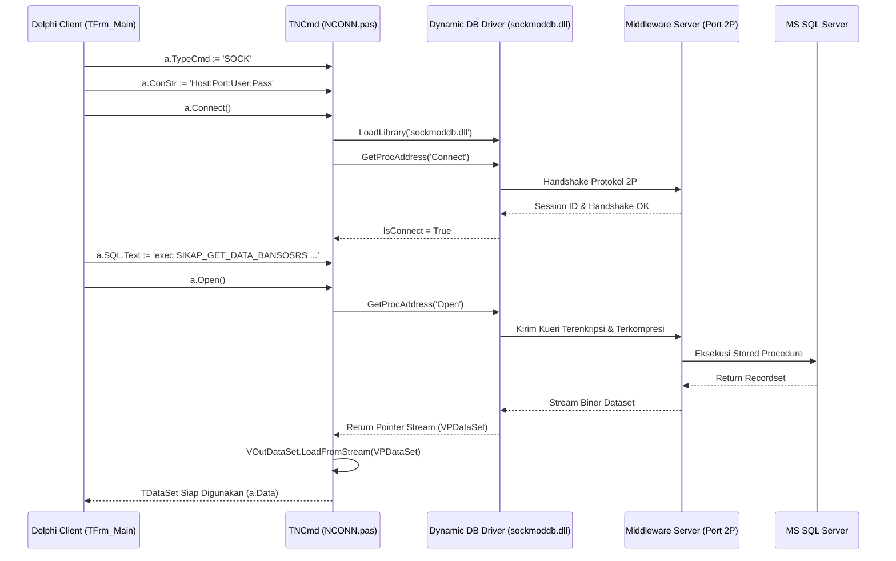
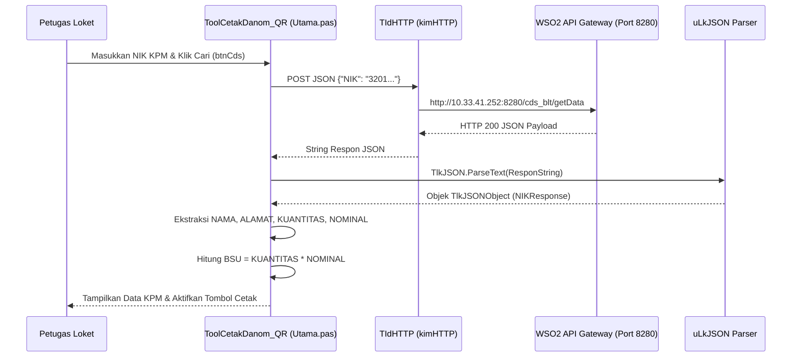
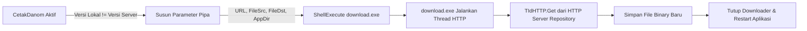

# 04. Identifikasi Mekanisme Middleware & Integrasi Jaringan

## 1. Arsitektur Middleware Proprietary NCONN

Aplikasi CetakDanom dibangun di atas modul middleware proprietary bernama **NCONN (Modul Standar Antar Muka Jaringan PT Pos Indonesia)** yang dikembangkan oleh tim TI internal PT Pos Indonesia:

| Informasi Modul | Rincian |
| :--- | :--- |
| **Nama Modul** | `NCONN.pas` |
| **Deskripsi** | Menyediakan akses ke database baik lokal, remote maupun lokal-remote dengan **Protokol 2P** |
| **Author** | Nasruddin Mohammad (`nas@posindonesia.co.id`) |
| **Tanggal / Versi** | 12 Mei 2005 / Versi 1.00 |
| **Dependencies Internal**| `FastShareMem`, `kbmMemTable` v5.00, `kbmMemBinaryStreamFormat`, `NCrypt`, `NSession`, `NZip`, `NFileData` |



---

## 2. Mekanisme Dynamic DLL Dispatching

Kelas `TNCmd` tidak mengikat driver database secara statis saat kompilasi, melainkan melakukan *dynamic late-binding* menggunakan Windows API `LoadLibrary` dan `GetProcAddress`:

```pascal
// Cuplikan NCONN.pas:224-235
hDll := LoadLibrary(PChar(Vtype + 'moddb.dll'));
// Vtype bernilai: 'sock', 'mssql', 'fb', atau 'mysql'
FuncPtr := GetProcAddress(hDll, PChar('Connect'));
@Func_Start := FuncPtr;
if (@Func_Start <> nil) then
begin
  IsConnect := Func_Start(@VConStr, @VDmz, @Err, VConn, VNSess, VZip, VCrypt);
end;
```

### Tabel Kontrak Fungsi Ekspor DLL (`stdcall`):
Setiap DLL driver (`*moddb.dll`) wajib mengimplementasikan fungsi-fungsi standar:
1. `Connect(ConnStr, Dmz, Err: PString; var Conn, NSess, Zip, Crypt: Pointer): Boolean; stdcall;`
2. `DisConnect(Conn: Pointer): Boolean; stdcall;`
3. `Open(Cmd, Conn, NSess, Zip, Crypt: Pointer; Dmz, Err: PString; var DtSet: Pointer): Boolean; stdcall;`
4. `ExecSql(Cmd, Conn, NSess, Zip, Crypt: Pointer; Dmz, Err: PString): Boolean; stdcall;`
5. `SendData(Cmd, Conn, NSess, Zip, Crypt: Pointer; Dmz, Err: PString): Boolean; stdcall;`
6. `SendDataSet(Cmd, Conn, NSess, Zip, Crypt: Pointer; Dmz, Err: PString): Boolean; stdcall;`
7. `SendFile(Cmd, Conn, NSess, Zip, Crypt: Pointer; Dmz, Err: PString): Boolean; stdcall;`

Pada mode `'SOCK'`, data yang dikembalikan oleh fungsi `Open` adalah *Memory Stream* biner terkompresi dari `TkbmMemTable` (`TkbmBinaryStreamFormat`), yang kemudian langsung dimuat menggunakan `VOutDataSet.LoadFromStream(VPDataSet)`.

---

## 3. Modul Kriptografi & Keamanan (`NCrypt.pas`)

Keamanan data penerima bantuan dan kredensial koneksi dikelola melalui kelas `TNHash` dan `TNCipher`:

| Komponen | Spesifikasi Teknis |
| :--- | :--- |
| **Author & Tanggal** | Nasruddin Mohammad, 21 Oktober 2004 |
| **Pustaka Pendukung** | `DCPcrypt v2.0` (David Barton) & Pustaka `MD5` |
| **Algoritma Enkripsi** | - **Tipe 0**: Plain (Tanpa Enkripsi)<br/>- **Tipe 1**: `Blowfish` (`TDCP_blowfish`) - **Default Operasional**<br/>- **Tipe 2**: `Twofish` (`TDCP_TwoFish`)<br/>- **Tipe 3**: `3DES` (`TDCP_3Des`)<br/>- **Tipe 4**: `RC4` (`TDCP_rc4`) |
| **Algoritma Hashing** | `MD5` (Message Digest 5) |
| **Pola Hash Password** | `StrToMD5(txt_UserId.Text + txt_Passwd.Text)` |
| **Custom RTTI FastScript** | `UFunction.pas` mendaftarkan fungsi `ToMD5()` ke engine FastReport PascalScript sehingga barcode kuitansi dapat menghitung hash MD5 secara dinamis saat laporan dicetak. |

---

## 4. Modul Kompresi Aliran Data (`NZip.pas`)

Untuk menghemat *bandwidth* koneksi WAN pos di daerah, data serialisasi dataset dikompresi sebelum dienkripsi dan dikirim melalui jaringan atau disimpan ke disk:

- **Engine Kompresi**: `ZLibEx` (Zlib v1.1.4 oleh Roberto Della Pasqua).
- **Tingkat Kompresi (`ZipType`)**:
  - `0`: Tanpa kompresi.
  - `1`: `zcFastest` (Kompresi cepat, rasio rendah).
  - `2`: `zcDefault` (Seimbang).
  - `3`: `zcMax` (Kompresi maksimal - **Default pada `conf.bns`**).
- **Format File `.bns` dan `.POS` Legacy**:
  ```
  [Raw TkbmMemTable Data] 
       └──> [ZLibEx Compress Stream (zcMax)] 
                 └──> [Blowfish Encrypt Stream] 
                           └──> [File *.POS / conf.bns]
  ```

---

## 5. Manajemen Status Sesi Koneksi (`NSession.pas`)

Untuk mengelola banyak koneksi konkruen secara aman pada middleware server/klien, unit `NSession` menyediakan kelas `TNSession`:
- Menggunakan `TThreadList` yang *thread-safe* untuk menyimpan objek sesi `TNSess`.
- **Atribut Sesi**: `SessionId` (string 32), `UserId` (string 32), `FirstCmd` (TDateTime), `LastCmd` (TDateTime), `Cmd` (Integer), `CryptType`, `CryptKey`, `ZipType`, `TimeOut`, dan `ThreadId`.
- **Fitur Otomatis**: Metode `DelTimeOut` untuk menghapus sesi-sesi yang mati atau melampaui ambang batas *timeout* tanpa memutus koneksi aktif lainnya.

---

## 6. Integrasi REST API Gateway Modern (CDS BLT)

Pada varian `ToolCetakDanom_QR`, ditambahkan integrasi ke infrastruktur RESTful Microservice di lingkungan enterprise PT Pos Indonesia:



- **Alamat Endpoint**: `http://10.33.41.252:8280/cds_blt/getData` (Fallback tercatat: `http://10.60.64.25:8280/cds_blt/1.0.0/getData`).
- **Port 8280**: Port standar *HTTP PassThrough Transport* pada **WSO2 Enterprise Service Bus / API Manager**.
- **Pustaka Parser JSON**: `uLkJSON` (Lightweight JSON parser untuk Delphi oleh Leonid Koninin).

---

## 7. Mekanisme Pembaruan Otomatis (*Auto-Update Pipeline*)

Pembaruan perangkat lunak tidak memanfaatkan installer Windows eksternal, melainkan mekanisme internal yang dipicu saat aplikasi mendeteksi versi yang tidak cocok dengan database:



- **Penyedia Berkas**: Web Server HTTP Internal (`http://10.33.41.172/download/Param/UpdateEXE/v4.2.0/`).
- **Format Parameter Pipa**: `tempURL|tempNmFileSrc|tempNmFileDst|tempDir|`.
- **Handling Multi-threading**: Downloader menjalankan proses unduh dalam *Windows Native Thread* (`BeginThread` / `TerminateThread`) agar UI progress bar (`TGauge`) tidak *freezing*.

