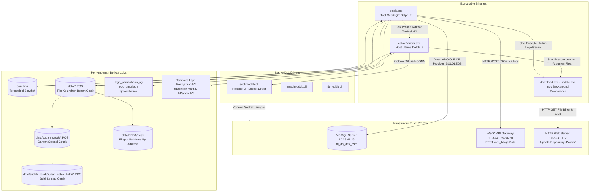
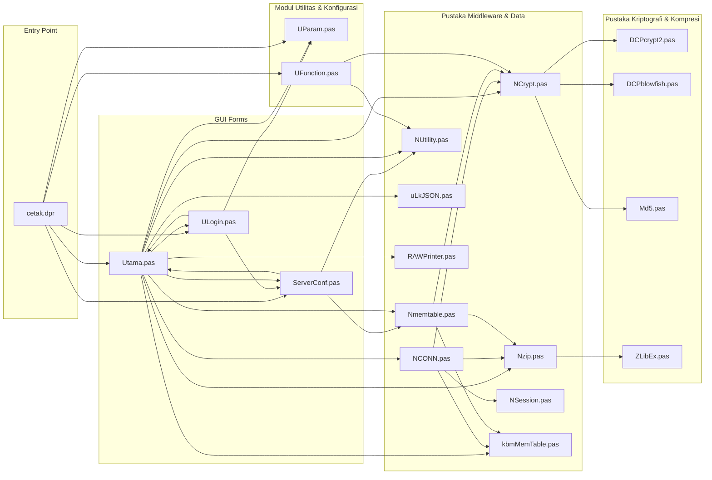

# 07. Peta Ketergantungan Antar Modul (*Dependency Map*)

## 1. Peta Ketergantungan Tingkat Proyek & Ekosistem

Aplikasi CetakDanom beroperasi sebagai ekosistem modular yang terdiri dari berkas biner eksekusi, pustaka dinamis (DLL), berkas konfigurasi lokal, pustaka template laporan eksternal, dan antarmuka jaringan terdistribusi:

---

## 2. Graf Ketergantungan Antar-Unit (*Unit Uses Graph*)

Berikut adalah pemetaan klausa `uses` antar unit Pascal dalam kode sumber `ToolCetakDanom_QR`:

---

## 3. Matriks Ketergantungan Unit (*Dependency Matrix*)

| Unit Pengguna (*Source*) | Unit / Pustaka yang Digunakan (*Target*) | Tujuan Penggunaan |
| :--- | :--- | :--- |
| **`cetak.dpr`** | `Forms`, `Utama`, `ServerConf`, `ULogin`, `UParam`, `UFunction` | Inisialisasi aplikasi, pembuatan form `Frm_Main`, `Frm_Login`, `Frm_Server`. |
| **`Utama.pas`** | `NCONN` | Komunikasi socket via protokol proprietary 2P. |
| | `NCrypt` | Dekripsi stream kbmMemTable pada pembacaan file `.POS`. |
| | `Nzip` | Dekompresi stream ZLib. |
| | `Nmemtable` | Operasi in-memory table dan penyimpanan file terenkripsi. |
| | `kbmMemTable` | Penyimpanan data lokal tabel Danom & konfigurasi. |
| | `ADODB` | Eksekusi kueri langsung SQL Server (`con1: TADOConnection`). |
| | `uLkJSON` | Penguraian (*parsing*) payload JSON dari gateway CDS BLT. |
| | `idHTTP` | Pemanggilan REST API POST ke WSO2 ESB. |
| | `RAWPrinter` | Pencetakan langsung instruksi teks ESC/P ke printer loket. |
| | `frxClass`, `frxBarcode` | Pembuatan laporan dan rendering 2D Barcode (QR Code). |
| | `frxExportPDF` | Ekspor dokumen hasil cetak ke format PDF. |
| | `Windows`, `ShellApi` | Integrasi Win32 API (`CreateMutex`, `ProcessExists`, `ShellExecute`). |
| **`ULogin.pas`** | `ADODB` | Autentikasi langsung ke SQL Server via `conADOLogincon`. |
| | `NUtility` | Fungsi hashing MD5 password petugas (`StrToMD5`). |
| | `UParam` | Pembacaan versi aplikasi saat login (`appVersi`). |
| **`ServerConf.pas`** | `Nmemtable` | Membaca & menyimpan tabel konfigurasi server `conf.bns`. |
| **`UFunction.pas`** | `fs_iinterpreter`, `NCrypt` | Mendaftarkan fungsi `ToMD5` ke FastScript RTTI FastReport. |
| **`NCONN.pas`** | `FastShareMem`, `kbmMemTable` | Manajemen alokasi memori stream dataset antar modul DLL. |
| | `Windows` | Dynamic loading driver DLL via `LoadLibrary` / `GetProcAddress`. |
| **`uUpdate.pas`** | `idHTTP`, `Gauges`, `ShellApi` | Unduh file binary via HTTP di thread terpisah (`BeginThread`). |

---

## 4. Ketergantungan Sistem Operasi Windows (*Win32 API Bindings*)

Aplikasi menggunakan sejumlah fungsi sistem operasi tingkat rendah (*native Win32 API*):

| Win32 API Function | DLL Windows | Lokasi Pemanggilan | Tujuan & Konsekuensi Teknis |
| :--- | :--- | :--- | :--- |
| `CreateMutexA` | `kernel32.dll` | `Utama.pas:656`, `ULogin.pas:176` | Mencegah aplikasi dijalankan lebih dari 1 instance (*Single Instance Lock*). |
| `CreateToolhelp32Snapshot` | `kernel32.dll` | `Utama.pas:333` | Mengambil daftar proses Windows untuk mendeteksi apakah `cetakDanom.exe` aktif. |
| `Process32First` / `Next` | `kernel32.dll` | `Utama.pas:335-346` | Iterasi nama proses pada memori Windows. |
| `BeginThread` / `TerminateThread` | `kernel32.dll` | `Utama.pas:766`, `uUpdate.pas:79` | Manajemen background thread untuk unduhan file tanpa membekukan antarmuka. |
| `MoveFileA` | `kernel32.dll` | `Utama.pas:921, 938` | Memindahkan file `.POS` antar folder untuk mengubah status siklus hidup dokumen. |
| `LoadLibraryA` / `GetProcAddress` | `kernel32.dll` | `NCONN.pas:224-230` | Memuat modul driver database pihak ketiga secara dinamis saat runtime. |
| `MessageBoxTimeoutA` | `user32.dll` | `Utama.pas:325` | Kotak dialog pesan Windows dengan timer tutup otomatis (*auto-dismiss*). |
| `ShellExecuteA` | `shell32.dll` | `Utama.pas:717`, `ULogin.pas:172` | Menjalankan aplikasi pembantu eksternal (`download.exe`, `update.exe`). |
| `OpenPrinter`, `WritePrinter` | `winspool.drv` | `RAWPrinter.pas:512-580` | Mengirim byte mentah melewati spooler Windows langsung ke port printer fisik. |

