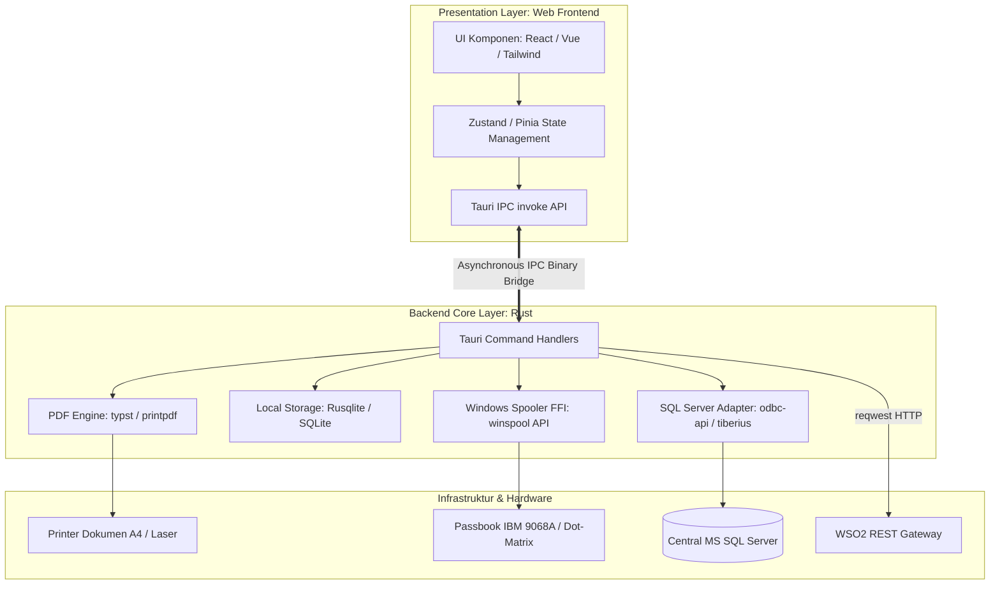

# 11. Analisis Risiko Migrasi ke Tauri (Rust + Web Frontend)

## 1. Evaluasi Kelayakan & Konsep Arsitektur Tauri

**Tauri (Tauri v2)** adalah framework desktop generasi modern yang menggabungkan backend berbasis **Rust** dengan antarmuka pengguna berbasis **Web Frontend (React, Vue, Svelte, atau Solid.js)** yang dirender melalui Microsoft Edge WebView2 bawaan Windows.



---

## 2. Matriks Analisis Risiko Migrasi ke Tauri

| Faktor Risiko | Probabilitas | Tingkat Dampak | Kategori Masalah | Deskripsi Risiko |
| :--- | :---: | :---: | :--- | :--- |
| **Presisi Cetak Laporan Web (`window.print`)** | **Pasti (100%)** | **Kritis** | Reporting & Layout | Mesin cetak browser CSS `@media print` tidak mampu menjamin pemisahan halaman (*strict pagination*) 20 baris per lembar pada form Danom dan rentan bergeser antar driver printer. |
| **Keterbatasan Spooler Printer Dot-Matrix / Passbook** | **Tinggi** | **Kritis** | Hardware / FFI | Frontend web tidak memiliki akses ke hardware. Backend Rust harus membangun antarmuka C-FFI ke Windows Spooler (`winspool.drv`) secara manual untuk mengirim byte ESC/P mentah. |
| **Kurva Pembelajaran Rust (*Talent & Learning Curve*)** | **Tinggi** | **Tinggi** | Sumber Daya Manusia | Bahasa Rust memiliki konsep *ownership*, *borrowing*, dan *unsafe FFI* yang jarang dikuasai oleh tim pengembang aplikasi internal perbankan/pos di Indonesia. |
| **Konektivitas Direct SQL Server dari Rust** | **Sedang** | **Tinggi** | Database Access | Driver TDS murni Rust (`tiberius`) atau `odbc-api` tidak se-matang ADO.NET dalam menangani tipe data variatif, stored procedure multi-result, dan OLE DB legacy. |
| **Ketergantungan Microsoft Edge WebView2 Runtime** | **Rendah** | **Sedang** | Client Environment | Pada PC loket yang masih menggunakan Windows 7 atau Windows 10 versi awal yang belum terinstal WebView2 Runtime, aplikasi Tauri tidak akan dapat berjalan sebelum runtime dipasang. |

---

## 3. Rincian Isu Kritis & Solusi Mitigasi

### A. Masalah Tata Letak Cetak: Web Print vs Headless Native PDF
- **Karakteristik Masalah**:
  - Dokumen Daftar Nominatif (Danom) memiliki aturan ketat: orientasi lanskap/potret tertentu, tabel rekening bergaris, jumlah baris per halaman tetap, serta teks legalitas bertanda tangan di lembar terakhir.
  - Cetak via browser (`window.print()`) memunculkan dialog pratinjau browser, margin yang diubah-ubah oleh pengguna, serta header/footer otomatis browser (*URL & tanggal*).
- **Solusi Mitigasi**:
  - **Jangan gunakan web printing untuk dokumen legalitas**.
  - Buat berkas PDF di sisi Rust backend menggunakan crate **`typst`** (engine dokumen typesetting modern berbasis Rust) atau **`printpdf`**.
  - Kirim berkas PDF hasil render langsung ke printer Windows menggunakan perintah native atau tool headless PDF printing.

---

### B. Pencetakan RAW Printer (Passbook IBM 9068A & Dot-Matrix)
- **Karakteristik Masalah**:
  - Teller pos membutuhkan pencetakan slip cepat pada buku tabungan atau kuitansi rangkap menggunakan jarum impact.
- **Solusi Mitigasi**:
  - Tulis modul FFI di Rust menggunakan crate `windows` (resmi dari Microsoft):
    ```rust
    use windows::Win32::Graphics::Printing::{
        OpenPrinterA, StartDocPrinterA, WritePrinter, EndDocPrinter, ClosePrinter, DOC_INFO_1A
    };

    pub fn print_raw_esc_pos(printer_name: &str, data: &[u8]) -> Result<(), String> {
        unsafe {
            let mut handle = Default::default();
            // OpenPrinter, StartDocPrinter, WritePrinter bytes ESC/P, ClosePrinter
        }
    }
    ```
  - Buat Tauri command: `#[tauri::command] fn print_passbook_slip(...)` yang dapat dipanggil dari React/Vue.

---

### C. Penanganan Kueri SQL Server di Rust
- **Karakteristik Masalah**:
  - Delphi menggunakan `conADOLogincon.Execute('exec SIKAP_LOGIN ...')`.
  - Pada Rust, crate `tiberius` (Async TDS) memerlukan runtime `tokio`. Eksekusi stored procedure SQL Server memerlukan penanganan tipe data dinamis.
- **Solusi Mitigasi**:
  - Alternatif A: Gunakan crate `odbc-api` dengan driver resmi *ODBC Driver 18 for SQL Server*.
  - Alternatif B (Sangat Direkomendasikan jika memilih Tauri): **Ubah arsitektur menjadi 3-Tier penuh**. Buat backend API Gateway berbasis REST/gRPC (misal: ASP.NET Core Web API) yang berhadapan langsung dengan SQL Server, sehingga Tauri murni bertindak sebagai *rich UI desktop client* yang berkomunikasi via HTTPS.

---

## 4. Evaluasi Beban Kerja & Rekomendasi Migrasi Tauri

| Komponen Arsitektur | Teknologi Target (Tauri) | Estimasi Hari Kerja |
| :--- | :--- | :---: |
| Antarmuka Pengguna (Web UI) | React / Vue 3 + TailwindCSS + Shadcn/ui | 12 Hari |
| Autentikasi & Integrasi SQL Server di Rust | Rust + odbc-api / tiberius | 8 Hari |
| Integrasi REST API (CDS BLT) | Rust + reqwest + serde_json | 3 Hari |
| Penyimpanan Lokal & Data Pipeline | SQLite (crate rusqlite) | 4 Hari |
| Mesin Laporan PDF & Barcode QR | Rust (typst / printpdf) + qrcode crate | 12 Hari |
| Modul Win32 Spooler Passbook (FFI) | Rust + windows-rs winspool | 5 Hari |
| Packaging & Auto-Update | Tauri v2 native updater | 3 Hari |
| Pengujian Kompatibilitas Hardware & PC Loket | Uji coba WebView2 di lingkungan Windows Pos | 8 Hari |
| **Total Estimasi Upaya** | | **55 Hari Kerja** |

> [!WARNING]
> **Kesimpulan & Rekomendasi**:
> Migrasi ke Tauri sangat menarik dari segi visual antarmuka modern dan ukuran biner yang kecil (< 15 MB). Namun, untuk sistem yang memiliki ketergantungan berat pada **pencetakan dokumen tabular presisi tinggi**, **hardware passbook printer**, dan **koneksi stored procedure SQL Server internal**, kompleksitas rekayasa FFI pada Rust dan keterbatasan print browser menjadikan **Tauri memiliki risiko teknis tertinggi** dibandingkan C# .NET.

