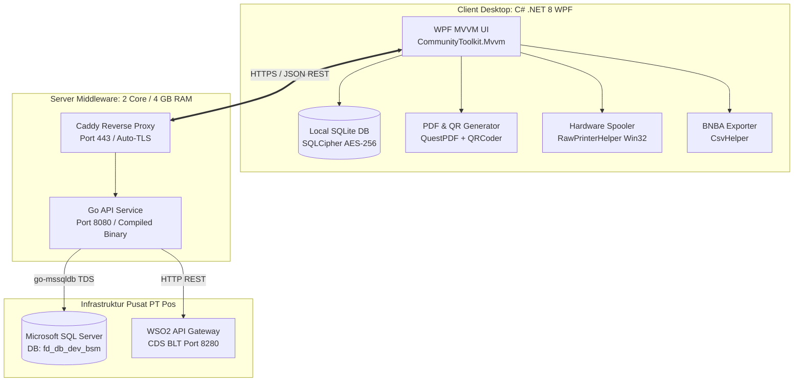

# 12. Rencana Implementasi & Timeline Migrasi: Client (C#) & Middleware API (Go)

Dokumen ini memuat panduan implementasi teknis bertahap (*step-by-step roadmap*) dan jadwal kerja (*timeline*) untuk modernisasi aplikasi **CetakDanom (FDPOS)** dari Delphi 5/7 ke arsitektur modern:
* **Client**: **C# (.NET 8 LTS)** berbasis **WPF (MVVM)** + **SQLite (SQLCipher AES-256)** + **QuestPDF** + **WinSpool P/Invoke**.
* **Middleware**: **Go API (Golang 1.22+)** + **Caddy Reverse Proxy (HTTPS/Auto-TLS)**.
* **Database Backend**: **Microsoft SQL Server Eksisting** (tanpa mengubah tabel dan Stored Procedure sama sekali).

---

## 1. Arsitektur Target & Pemetaan Komponen Eksisting



### Tabel Pemetaan Komponen Delphi ke Modern Stack

| Fitur / Modul Delphi Eksisting | Komponen Delphi Lama | Komponen Modern Baru | Keterangan & Catatan |
| :--- | :--- | :--- | :--- |
| **Login & Auth** | `ULogin.pas`, `NCONN` | `C# LoginView` & Go `/api/v1/auth/login` | Memanggil `SIKAP_LOGIN` via Go API; password di-hash MD5. |
| **Mode Offline** | Hotkey `F5` pada `ULogin` | `OfflineModeService` pada C# | Otomatis/manual membaca database lokal SQLite saat jaringan terputus. |
| **Data Extraction & Split**| `Utama.pas:GetData` & `memKelurahan` | Go `/api/v1/danom/kelurahan` & C# Sync | Go mengeksekusi `SIKAP_GET_DATA_BANSOSRS`, C# menyimpan batch ke SQLite. |
| **Penyimpanan Lokal** | File `.POS` (kbmMemTable binary / text) | **SQLite + SQLCipher** (`danom_local.db`) | Enkripsi transparan AES-256; menggantikan flat file `.POS`. |
| **State Machine Dokumen**| Folder `data/`, `sudah_cetak/` | Kolom status di SQLite (`status_cetak_danom`) | Mengeliminasi risiko file hilang saat dipindahkan antar folder. |
| **Ekspor BNBA** | `btn_BNBAClick` CSV semi-colon | `BnbaExportService` (C#) | Format 14 kolom persis dengan prefiks backtick (`` ` ``) pada NIK/Danom. |
| **Cetak Danom** | `frDanom.fr3` (FastReport) | `DanomDocument` (QuestPDF) | Render presisi tinggi format PDF tabel nominatif bergaris legalitas. |
| **Cetak Bukti Terima & QR** | `frBuktiTerima.fr3` | `BuktiTerimaDocument` (QuestPDF + QRCoder)| Dynamic multi-tahap (1 s.d. 3 barcode QR) sesuai selisih tahap. |
| **Surat Pernyataan** | `Pernyataan.fr3` | `PernyataanDocument` (QuestPDF) | Cetak komitmen kepatuhan sembako 4 komoditas pangan. |
| **Cetak Passbook / Slip** | `RAWPrinter.pas` | `RawPrinterHelper` (C# P/Invoke WinSpool) | Kirim byte mentah ESC/P ke printer IBM 9068A / Epson LQ-300. |
| **CDS BLT (Online)** | `Button3Click` (TIdHTTP + uLkJSON) | Go `/api/v1/cds/nik` & C# View | Pengecekan real-time NIK KPM susulan ke API Gateway WSO2. |
| **Auto-Updater** | `downloadParam` (`download.exe`) | `Velopack` atau Native Go manifest update | Pembaruan aplikasi otomatis tanpa memerlukan instalasi ulang manual. |

---

## 2. Rencana Kerja Bertahap (*Step-by-Step Roadmap*)

### TAHAP 1: Pembangunan Middleware Go API & Caddy (Minggu 1 – 2)

#### Langkah 1.1: Inisialisasi Proyek Go & Struktur Modular
1. Inisialisasi Go Module:
   ```bash
   mkdir fdpos-api && cd fdpos-api
   go mod init posindonesia.co.id/fdpos-api
   ```
2. Struktur folder standar *Clean Architecture*:
   ```
   fdpos-api/
   ├── cmd/server/main.go
   ├── config/config.go
   ├── internal/
   │   ├── auth/ (handler, service, repository)
   │   ├── wilayah/ (handler, service, repository)
   │   ├── danom/ (handler, service, repository)
   │   └── cds/ (handler, client)
   ├── pkg/database/mssql.go
   └── Caddyfile
   ```

#### Langkah 1.2: Implementasi Konektor Database MSSQL
1. Pasang driver resmi Microsoft:
   ```bash
   go get github.com/microsoft/go-mssqldb
   ```
2. Buat koneksi pool di `pkg/database/mssql.go`:
   ```go
   connString := fmt.Sprintf("server=%s;user id=%s;password=%s;database=%s;encrypt=disable", 
       cfg.DBHost, cfg.DBUser, cfg.DBPass, cfg.DBName)
   db, err := sql.Open("sqlserver", connString)
   db.SetMaxOpenConns(25)
   db.SetMaxIdleConns(5)
   ```

#### Langkah 1.3: Pembuatan Endpoint Endpoint API Inti
1. **Autentikasi (`POST /api/v1/auth/login`)**:
   * Menerima: `{ "user_id": "...", "password": "..." }`.
   * Menghitung hash MD5: `fmt.Sprintf("%x", md5.Sum([]byte(req.UserID + req.Password)))`.
   * Memanggil SP: `EXEC SIKAP_LOGIN @ID_PETUGAS, @PASS_PETUGAS, @APPVERSI`.
   * Mengurai string pipa `IdPetugas|Nippos|Nama|Nopend|Kantor|Jabatan` & menerbitkan JWT Token.
2. **Hierarki Wilayah (`GET /api/v1/wilayah/...`)**:
   * Layanan: `EXEC SIKAP_GET_LAYANAN`
   * Tahap: `EXEC SIKAP_GET_TAHAP`
   * Kabupaten: `EXEC SIKAP_GET_KABUPATEN @NOPEND, @ID_PETUGAS, @NIPPOS, @JENIS`
   * Kecamatan: `EXEC SIKAP_GET_KECAMATAN @ID_KABUPATEN, @NOPEND, @ID_PETUGAS, @NIPPOS, @JENIS`
   * Kelurahan: `EXEC SIKAP_GET_KELURAHAN_BYKEC @ID_KECAMATAN, @NOPEND, @ID_PETUGAS, @NIPPOS, @JENIS`
3. **Ekstraksi Danom Kelurahan (`GET /api/v1/danom/batch`)**:
   * Memanggil SP: `EXEC SIKAP_GET_DATA_BANSOSRS @ID_KELURAHAN, @JENIS, '0'`.
   * Mengembalikan JSON array 24 kolom terkompresi Gzip.
4. **Proxy CDS BLT (`POST /api/v1/cds/cek-nik`)**:
   * Melakukan forward HTTP POST JSON `{"NIK": "..."}` ke WSO2 Gateway (`10.33.41.252:8280/cds_blt/getData`).

#### Langkah 1.4: Konfigurasi Caddy Reverse Proxy
Buat file `Caddyfile` untuk mengamankan akses API:
```caddy
fdpos-api.posindonesia.co.id {
    reverse_proxy localhost:8080 {
        header_up X-Real-IP {remote_host}
    }
    encode gzip zstd
    tls internal
}
```

---

### TAHAP 2: Pembangunan Client C# & Local Encrypted Database (Minggu 3 – 4)

#### Langkah 2.1: Setup Solusi .NET 8 & Library
1. Buat solusi WPF .NET 8:
   ```bash
   dotnet new wpf -n CetakDanom.Client
   ```
2. Pasang paket NuGet esensial:
   ```bash
   dotnet add package CommunityToolkit.Mvvm
   dotnet add package Microsoft.Data.Sqlite
   dotnet add package SQLitePCLRaw.bundle_e_sqlcipher
   dotnet add package QuestPDF
   dotnet add package QRCoder
   dotnet add package CsvHelper
   dotnet add package MaterialDesignThemes
   ```

#### Langkah 2.2: Implementasi Database Lokal Terenkripsi (SQLCipher)
1. Buat kelas `DatabaseContext.cs`:
   ```csharp
   var connectionStringBuilder = new SqliteConnectionStringBuilder
   {
       DataSource = Path.Combine(AppDomain.CurrentDomain.BaseDirectory, "danom_local.db"),
       Password = "KunciEnkripsiRahasiaClientPos2026!" // Kunci AES-256
   };
   using var connection = new SqliteConnection(connectionStringBuilder.ConnectionString);
   connection.Open();
   ```
2. Buat tabel `DanomBeneficiary` lengkap dengan kolom pelacak status:
   * `IdPelanggan`, `Nama`, `Alamat`, `Nominal`, `Nik`, `IdKelurahan`, `Kelurahan`, `Kecamatan`, `Kabupaten`, `Tahap`, `StatusCetakDanom`, `StatusCetakBukti`, `WaktuCetak`.

#### Langkah 2.3: Layanan Sinkronisasi Data & Mode Offline (F5)
1. **Sinkronisasi**: Menarik batch data dari Go API per kelurahan terpilih, lalu melakukan *bulk insert* ke SQLite lokal dalam 1 transaksi database.
2. **Penanganan F5**: Jika koneksi ke Go API mati atau user menekan F5 di layar login, sistem berpindah ke status `IsOfflineMode = true`. Sistem langsung mengarahkan ke dashboard pembacaan SQLite lokal tanpa validasi server.

---

### TAHAP 3: Reporting Engine & Hardware Printing (Minggu 5 – 6)

#### Langkah 3.1: Re-authoring Template Laporan dengan QuestPDF
1. **Laporan Cetak Danom (`DanomDocument.cs`)**:
   * Mengatur ukuran kertas A4 landscape/portrait, margin standar.
   * Header berulang di setiap halaman: Logo Pos, Informasi Wilayah (Provinsi, Kabupaten, Kecamatan, Kelurahan).
   * Tabel detail 20 baris per halaman, kolom nomor urut, rekening, nama, alamat, nominal, dan kotak tanda tangan.
   * Footer total berjalan (*running total*) dan rekapitulasi jumlah uang per lembar.
2. **Kuitansi Bukti Terima dengan Barcode 2D QR (`BuktiTerimaDocument.cs`)**:
   * Generate QR Code via `QRCoder`:
     ```csharp
     var qrData = $"{item.IdPelanggan}{tahap}|{item.Nik}|{item.Nama}|{item.AlamatKtp}|{item.Alamat}|{item.Nominal}";
     using var qrGenerator = new QRCodeGenerator();
     var qrCodeData = qrGenerator.CreateQrCode(qrData, QRCodeGenerator.ECCLevel.M);
     var qrCode = new PngByteQRCode(qrCodeData);
     byte[] qrBytes = qrCode.GetGraphic(20);
     ```
   * Logika percabangan tahap (1 s.d. 3 tahap) dirender secara modular dalam layout kartu tanda terima.
3. **Surat Pernyataan Tanggung Jawab Sembako (`PernyataanDocument.cs`)**:
   * Teks legalitas 4 komoditas pangan + biodata KPM + kotak tanda tangan bermaterai.

#### Langkah 3.2: Implementasi Driver RAW Printer (Passbook & Dot-Matrix)
Buat modul Win32 P/Invoke di `Hardware/RawPrinterHelper.cs`:
```csharp
public static class RawPrinterHelper
{
    [DllImport("winspool.drv", CharSet = CharSet.Ansi, ExactSpelling = true)]
    public static extern bool OpenPrinter(string pPrinterName, out IntPtr phPrinter, IntPtr pDefault);

    [DllImport("winspool.drv", ExactSpelling = true)]
    public static extern bool StartDocPrinter(IntPtr hPrinter, int level, [In] DOCINFOA di);

    [DllImport("winspool.drv", ExactSpelling = true)]
    public static extern bool WritePrinter(IntPtr hPrinter, IntPtr pBytes, int dwCount, out int dwWritten);

    public static void SendEscPosToPrinter(string printerName, byte[] commands)
    {
        // Implementasi pembukaan printer, penulisan byte mentah ESC/P, form feed, dan penutupan handle
    }
}
```

---

### TAHAP 4: Integrasi End-to-End, Ekspor BNBA, & Pengujian Fitur (Minggu 7)

1. **Ekspor BNBA CSV**:
   * Implementasi menggunakan `CsvHelper` dengan delimitasi titik koma (`;`).
   * Terapkan *custom converter* untuk field `NIK` dan nomor `DANOM` agar secara otomatis diawali karakter backtick (`` ` ``) untuk perlindungan format saat dibuka di Excel.
2. **State Machine Cetak**:
   * Saat user menekan tombol "Cetak Danom":
     1. Ekspor file BNBA ke folder `C:\DanomData\BNBA\`.
     2. Munculkan pratinjau PDF / Cetak langsung.
     3. Update SQLite: `UPDATE DanomBeneficiary SET StatusCetakDanom = 1 WHERE IdKelurahan = @Id`.
3. **Modul CDS BLT Real-time**:
   * User mengetik NIK &rarr; C# memanggil Go API &rarr; Go API menembak WSO2 &rarr; Tampilkan identitas KPM di UI &rarr; Tombol cetak slip passbook/kuitansi aktif.

---

### TAHAP 5: Uji Coba Hardware Lapangan, Hardening, & Deployment (Minggu 8)

1. **Pengujian Kompatibilitas Hardware**:
   * Uji coba cetak printer dot-matrix loket (Epson LQ-300 / LX-310).
   * Uji coba cetak passbook printer (IBM 9068A / Olivetti PR2 Plus).
   * Uji coba cetak laser/inkjet A4 untuk dokumen Danom.
2. **Stress Test Server Middleware (2 Core / 4 GB)**:
   * Menguji beban konkuren 50–100 request/detik pada Go API + Caddy menggunakan k6 / Apache Benchmark untuk memastikan RAM tetap stabil di bawah 150 MB.
3. **Deployment**:
   * Konfigurasi Caddy service & Go API service (via NSSM / Windows Service) pada server middleware.
   * Packaging Client C# menjadi file installer mandiri (*Self-Contained Single File Executable*).

---

## 3. Jadwal Kerja / Timeline Proyek (8 Minggu / 2 Bulan)

```
MINGGU KE-        : [M1] [M2] [M3] [M4] [M5] [M6] [M7] [M8]
─────────────────────────────────────────────────────────────
1. Backend (Go API)
   - Setup & MSSQL Driver   [██]
   - SP Hierarki & Auth          [██]
   - Batch Danom & CDS           [██]
   - Caddy Reverse Proxy              [██]

2. Client (C# & SQLite)
   - Setup WPF MVVM & UI              [██]
   - SQLite + SQLCipher               [██]
   - Sync Service & Offline F5             [██]

3. Reporting & Hardware
   - QuestPDF Cetak Danom                       [██]
   - Cetak Kuitansi QR & Sembako                     [██]
   - RawPrinter WinSpool (Passbook)                  [██]

4. Business Rules & Polish
   - BNBA CSV Exporter & State Lock                       [██]
   - CDS BLT UI Integration                              [██]

5. QA & Deployment
   - Uji Coba Hardware Printer Loket                           [██]
   - Server Hardening & Pilot Kantor Cabang                    [██]
```

---

## 4. Alokasi Tim & Kebutuhan Sumber Daya

| Peran | Alokasi | Tanggung Jawab Utama |
| :--- | :---: | :--- |
| **Backend Developer (Go)** | 1 Orang | Membangun Go API, mapping SP MSSQL, integrasi WSO2, setup Caddy. |
| **Desktop Developer (C#)** | 1 Orang | Membangun UI WPF, integrasi SQLite SQLCipher, QuestPDF, dan P/Invoke Spooler. |
| **QA / Hardware Tester** | 1 Orang (Part-time) | Uji coba fisik di loket kantor pos (printer passbook, dot-matrix, scanner QR). |
| **Database Administrator**| Pendampingan | Memberikan akses kueri/SP ke server SQL Server `fd_db_dev_bsm`. |

