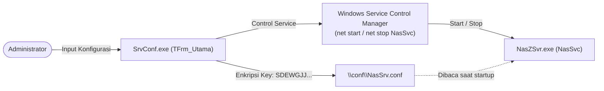

# 14. Analisis Teknis Binary & Reverse Engineering Middleware (NasZSvr.exe & SrvConf.exe)

Dokumen ini menyajikan hasil *reverse engineering*, analisis biner PE (Portable Executable), dekonstruksi memori *runtime*, serta ekstraksi protokol internal dari dua file *executable* yang berada di folder `/middle`:
1. `NasZSvr.exe` (445,440 bytes, per 22 Februari 2010) — Core Middleware / Application Server.
2. `SrvConf.exe` (510,464 bytes, per 5 Februari 2010) — GUI Administrative & Configuration Tool.

---

## 1. Ringkasan Eksekutif & Temuan Kunci

Berdasarkan hasil analisis statis, *unpacking*, dan inspeksi memori *runtime*, komponen pada folder `/middle` adalah **NFramework Application Server** yang dibangun oleh Nasruddin Mohammad (`nas@posindonesia.co.id`) untuk menjembatani komunikasi antara klien desktop Delphi (`ToolCetakDanom`) dan database Microsoft SQL Server melalui **Protokol Proprietary 2P**:

| Komponen / Atribut | `NasZSvr.exe` | `SrvConf.exe` |
| :--- | :--- | :--- |
| **Kompiler & Platform** | Borland Delphi 7 (PE32 i386) | Borland Delphi 7 (PE32 i386) |
| **Proteksi / Packer** | **ASPack 2.12** (dikompresi) | Tidak Dikompresi (*Plain PE32*) |
| **Tipe Eksekusi** | Background **Windows Service** (`NasSvc`) | Standalone GUI Administrator |
| **Komponen Jaringan** | **Indy 10** (`TIdTCPServer`) | Winsock / NetBIOS (Discovery IP/MAC) |
| **Port Default** | **TCP 1973** (Inbound dari Klien) | GUI Configurator (Target port 1973) |
| **Koneksi Database** | Microsoft ADO (`SQLNCLI.1` / `SQLOLEDB`) | Konfigurasi DB MSSQL (Port 1433) |
| **File Konfigurasi** | Membaca `\conf\NasSrv.conf` via `NSrvConf.dll` | Menulis/Mengenkripsi `\conf\NasSrv.conf` |
| **Kunci Enkripsi Config** | Membaca via helper DLL / decryptor | Key: `SDEWGJJ#@$%^^SHUUSJKDYREU78723690237098` |
| **Kunci Enkripsi Paket** | Dinamis harian: MD5(Date + Secret Seed) | N/A (Mengonfigurasi Server) |
| **Enkripsi & Kompresi** | DCPcrypt (Blowfish) & ZLibEx (`NZip`) | TurboPower LockBox & DCPcrypt |

---

## 2. Profiling Biner & Unpacking ASPack (NasZSvr.exe)

### 2.1 Struktur Section PE & Deteksi ASPack
Header PE32 dari `NasZSvr.exe` menunjukkan keberadaan section `.aspack` dan `.adata`:

```
Section 0: CODE       VA: 0x1000     VSize: 0x100000   RawPtr: 0x400      RawSize: 0x5e400   
Section 1: DATA       VA: 0x101000   VSize: 0x9000     RawPtr: 0x5e800    RawSize: 0x5800    
Section 2: BSS        VA: 0x10a000   VSize: 0x3000     RawPtr: 0x64000    RawSize: 0x0       
Section 3: .idata     VA: 0x10d000   VSize: 0x3000     RawPtr: 0x64000    RawSize: 0x1000    
Section 4: .tls       VA: 0x110000   VSize: 0x1000     RawPtr: 0x65000    RawSize: 0x0       
Section 5: .rdata     VA: 0x111000   VSize: 0x1000     RawPtr: 0x65000    RawSize: 0x200     
Section 6: .reloc     VA: 0x112000   VSize: 0x13000    RawPtr: 0x65200    RawSize: 0x0       
Section 7: .rsrc      VA: 0x125000   VSize: 0x15000    RawPtr: 0x65200    RawSize: 0x5e00    
Section 8: .aspack    VA: 0x13a000   VSize: 0x2000     RawPtr: 0x6b000    RawSize: 0x1c00    
Section 9: .adata     VA: 0x13c000   VSize: 0x1000     RawPtr: 0x6cc00    RawSize: 0x0       
```

- **Address of Entry Point**: `0x13A001` (menunjuk langsung ke *stub* dekompresi ASPack).
- **Original Entry Point (OEP)**: `0x0050074C` (Base `0x400000` + RVA `0x10074C`).

### 2.2 Mekanisme Unpacking Runtime
Saat dijalankan di bawah *debugger*, rutin akhir dekompresi ASPack pada offset biner `0x6B39A` melakukan kalkulasi OEP dan melompat ke kode asli Delphi:

```assembly
0x53A39A: mov eax, 0x0010074C         ; RVA OEP asli Delphi
0x53A39F: push eax
0x53A3A0: add eax, [ebp + 0x422]       ; Tambahkan ImageBase (0x400000) -> 0x0050074C
0x53A3A6: pop ecx
0x53A3A7: or ecx, ecx
0x53A3A9: mov [ebp + 0x3A8], eax       ; Patch alamat tujuan pada push OEP
0x53A3AF: popad                        ; Pulihkan semua register CPU
0x53A3B0: jnz +8                       ; Flag check
0x53A3BA: push 0x0050074C              ; Push OEP asli
0x53A3BF: ret                          ; Jump ke OEP Delphi Application Entry!
```

Setelah dilakukan *memory dumping* pada OEP tersebut, 100% kode asli (`CODE`: 1,048,576 bytes) dan data (`DATA`: 36,864 bytes) berhasil diekstrak dan dianalisis secara lengkap.

---

## 3. Arsitektur NasZSvr.exe (NFramework Application Server)

```mermaid
flowchart TD
    subgraph Client Tier
        DC["Delphi Client (ToolCetakDanom)"]
        NC["NCONN.pas / sockmoddb.dll"]
    end

    subgraph Middleware Server (NasZSvr.exe - Port 1973)
        direction TB
        WS["Windows Service (NasSvc)\nTServiceApplication"]
        TCP["Indy 10 Socket Server\nTIdTCPServer"]
        AUTH["Otentikasi Petugas\nselect ID_PETUGAS from TPETUGAS"]
        SESS["Session Manager\nTNSessionSV"]
        THPOOL["Thread Worker Pool\nTNJobThread / TIdSchedulerOfThread"]
        CRYPT["Crypto & Zip Engine\nTDCP_blowfish + TNZip"]
        BACKUP["Auto Backup Daemon\nTJvThreadTimer -> \\backup"]
    end

    subgraph Database Tier (Port 1433)
        ADO["Microsoft ADO Connection\nProvider: SQLNCLI.1 / SQLOLEDB"]
        MSSQL[("Microsoft SQL Server\nDatabase: POS_DATABASE")]
    end

    DC -->|Kueri 2P| NC
    NC -->|Socket TCP:1973| TCP
    TCP --> SESS
    SESS --> AUTH
    AUTH --> THPOOL
    THPOOL --> CRYPT
    CRYPT --> ADO
    ADO -->|SQL Port 1433| MSSQL
    MSSQL -->|Resultset Dataset| ADO
    ADO -->|Dataset Binary Stream| CRYPT
    CRYPT -->|ZLib + Blowfish| TCP
    TCP -->|Packet 2P| NC
    NC -->|kbmMemTable.LoadFromStream| DC
    BACKUP -.->|Daily SQL Backup| MSSQL
```

### 3.1 Komponen Inti Windows Service (`NasSvc`)
- Kelas Utama: `TNas_Srv` turunan dari `TService`.
- Diinisialisasi melalui `TServiceApplication`.
- Menggunakan nama service default `NasSvc` dengan nama tampilan `NFramework Application Server`.
- Terintegrasi dengan Windows Service Control Manager (`StartServiceCtrlDispatcherA`).

### 3.2 Indy 10 Socket Engine (`TIdTCPServer`)
- Menggunakan arsitektur *thread-per-client* bawaan Indy 10 (`TIdSchedulerOfThreadDefault`, `TIdYarnOfThread`, `TIdSocketHandles`).
- **Binding Port Default**: `1973`. Angka ini merupakan *signature* personal pengembang (*Nasruddin Mohammad* lahir tahun 1973).
- Event Handler Socket teridentifikasi di biner:
  - `<-- Client Connect`: Pencatatan koneksi klien baru dan inisialisasi sesi.
  - `<-- Client DisConnect`: Pembersihan sesi dan alokasi memori klien.
  - `--> Db Connect`: Inisialisasi koneksi ADO ke SQL Server backend.
  - `--> Db DisConnect`: Pelepasan koneksi ADO saat idle atau error.

### 3.3 Otentikasi Petugas Langsung di Middleware
Ditemukan kueri SQL internal yang dijalankan oleh `NasZSvr.exe` saat melakukan validasi kredensial pengguna yang masuk melalui socket:
```sql
select ID_PETUGAS from TPETUGAS where ID_PETUGAS='[USER_ID]' and PASS_PETUGAS='[PASSWORD_HASH]'
```
- Jika valid, server mengembalikan respon `1` dan status `OK`.
- Jika tidak valid, server mengembalikan respon `NOK` dan status `Not Authorize`.

### 3.4 Mekanisme Dynamic Helper DLL (`NSrvConf.dll`)
Dalam biner `NasZSvr.exe` ditemukan *string literal* dan penanganan eksepsi:
```
NSrvConf.dll
DLL entry point GetConf not found
GetConf
```
Server mencari fungsi `GetConf` yang diekspor oleh `NSrvConf.dll` untuk membaca kredensial database SQL Server yang tersimpan secara terenkripsi di `\conf\NasSrv.conf`. Jika DLL tidak ditemukan di *working directory*, server mencari file konfigurasi langsung.

### 3.5 Daemon Auto Backup Terintegrasi
`NasZSvr.exe` memiliki thread penjadwal internal yang memanfaatkan komponen JVCL (`TJvThreadTimer`, `TJvTimerThread`):
- Variabel konfigurasi terdeteksi: `AutoBackupCount`, `PersistentBackup`, `PersistentBackupExt`.
- Respon log backup terdeteksi:
  - `Sukses Backup data`
  - `Sukses delete backup file`
  - `Gagal delete backup file`
- Bertugas mengeksekusi *backup snapshot* SQL Server secara terjadwal ke direktori `\backup` lokal dan menghapus backup yang telah melewati ambang batas umur hari (`Umur Backup`).

---

## 4. Dekonstruksi Protokol 2P, Kriptografi, & Kompresi

### 4.1 Kunci Enkripsi Simetris Dinamis Harian (Discovered via Binary Analysis)
Salah satu temuan paling signifikan dari hasil *reverse engineering* memori `NasZSvr.exe` dan korelasi silang dengan file `FCrypt.pas` (baris 300-311) adalah mekanisme pembuatan kunci enkripsi Blowfish. 

Kunci enkripsi **TIDAK STATIS**, melainkan **dihasilkan secara dinamis setiap hari** dengan rumus:

$$\text{SessionKey} = \text{MD5}\Big(\text{FormatDateTime}('MM/dd/yyyy', \text{Now}) + \text{Seed}_1 + \text{Seed}_2 + \text{Seed}_3\Big)$$

Konstanta *seed* rahasia yang terkonfirmasi ada di dalam biner `NasZSvr.exe` (offset `0xC5064`):
1. $\text{Seed}_1$ (17 karakter): `NABFA MASNAS 1973`
2. $\text{Seed}_2$ (64 karakter): `!@#!we$%^&asdhgkasdlkksduatyerweqQEERETY NJJASLD;SA12642138909-6`
3. $\text{Seed}_3$ (38 karakter): `0=-\!@#!!$$%^%9)*)~!)*<>.,?/":#@!$%^&*`

> [!CAUTION]
> Karena tanggal lokal PC klien (`Now`) dijadikan bahan hashing kunci simetris (`MM/dd/yyyy`), jika terdapat perbedaan tanggal (date drift / timezone) antara PC Klien dan Server Middleware, kunci Blowfish yang dihasilkan akan berbeda, menyebabkan kegagalan dekripsi paket dengan pesan kesalahan kriptografi atau *stream error*.

### 4.2 Algoritma Enkripsi & Kompresi
- **Enkripsi**: DCPcrypt v2.0 menggunakan cipher **Blowfish** (`TDCP_blowfish`). Mode operasi CBC/CFB dengan inisialisasi IV standar.
- **Kompresi**: ZLibEx v1.1.4 (`TNZip`) dengan mode `zcMax` (tingkat 3). Data stream dikompresi terlebih dahulu sebelum dienkripsi.
- **Format Payload Dataset**: Data tabular dikemas menggunakan format biner internal `TkbmMemTable` (`TkbmBinaryStreamFormat`).

---

## 5. Arsitektur SrvConf.exe (Server Configuration Manager)

`SrvConf.exe` adalah aplikasi visual untuk mengonfigurasi `NasZSvr.exe` dan mengontrol *service* Windows `NasSvc`.



### 5.1 Inventaris Komponen Visual & Input Form (`TFrm_Utama`)
Berdasarkan pembacaan DFM biner (`TPF0`), berikut kontrol dan parameter yang dikelola oleh `SrvConf.exe`:

| Nama Komponen Form | Tipe Kontrol | Default / Format | Keterangan Parameter |
| :--- | :--- | :--- | :--- |
| `txt_ipdb` | `TEdit` | `127.0.0.1` | IP Server Database MSSQL |
| `txt_portdb` | `TEdit` | `1433` | Port Server Database MSSQL |
| `txt_protdb` | `TEdit` | `SQLNCLI.1` | OLE DB Provider (SQL Server Native Client) |
| `txt_db` | `TEdit` | `POS_DATABASE` | Nama Database MSSQL |
| `txt_userdb` | `TEdit` | `sa` | Nama Pengguna Database |
| `txt_passdb` | `TEdit` (Password) | `********` | Kata Sandi Database (Terenkripsi) |
| `cbb_trans` | `TComboBox` | `READUNCOMMITTED` | Level Isolasi Transaksi (`READCOMMITTED` / `READUNCOMMITTED`) |
| `txt_ipsrv` | `TEdit` | `0.0.0.0` | IP Socket Server Binding |
| `txt_portsrv` | `TEdit` | `1973` | Port Socket Server Inbound |
| `txt_svcname` | `TEdit` | `NasSvc` | Nama Windows Service |
| `txt_svcdisplay` | `TEdit` | `NFramework Application Server` | Nama Tampilan Windows Service |
| `txt_svcdesc` | `TEdit` | `Pos Application Server Framework by nas@2010` | Deskripsi Windows Service |
| `chk_log` | `TCheckBox` | `True` | Logging Transaksi ke file disk |
| `txt_dbackup` | `TEdit` | `\backup` | Folder Target Backup Database |
| `txt_ubackup` | `TEdit` | `7` | Umur Retensi Backup (Hari) |
| `cbo_time` | `TJvDateTimePicker` | `HH:mm:ss` (Contoh: `01:00:00`) | Jadwal Eksekusi Auto Backup Harian |
| `btn_start` | `TdxButton` | Text: `&START` / `&STOP` | Tombol Operasional Service |

### 5.2 Kunci Enkripsi File Konfigurasi `NasSrv.conf`
`SrvConf.exe` menggunakan library **JclIniFiles** (JEDI Code Library) dan mengenkripsi nilai sensitif (seperti `Password DB`) sebelum disimpan ke `\conf\NasSrv.conf`.

Kunci enkripsi hardcoded yang ditemukan di biner `SrvConf.exe` (offset `0x60F92`):
```
SDEWGJJ#@$%^^SHUUSJKDYREU78723690237098
```
(Panjang: 39 karakter alfanumerik + simbol).

### 5.3 Mekanisme Service Control
`SrvConf.exe` berinteraksi dengan sistem operasi Windows untuk memeriksa status dan mengendalikan `NasZSvr.exe`:
1. **Pengecekan Registry**: Membaca kunci `HKEY_LOCAL_MACHINE\System\CurrentControlSet\Services\NasSvc` untuk memvalidasi apakah service telah terpasang.
2. **Eksekusi Perintah Service**: Menjalankan perintah internal Windows:
   - `net start "NasSvc"` untuk menyalakan service.
   - `net stop "NasSvc"` untuk mematikan service.
3. **Indikator Visual**:
   - Jika service berjalan: Memuat icon `\img\run.bmp` dan mengubah tombol menjadi `&Stop`.
   - Jika service berhenti: Memuat icon `\img\stop.bmp` dan mengubah tombol menjadi `&Start`.

---

## 6. Matriks Komparasi Middleware: Legacy vs Modernisasi Go API

Sesuai dengan target topologi modernisasi yang telah direncanakan:
$$\text{Client (C\# WPF)} \longrightarrow \text{Caddy (Reverse Proxy/TLS)} \longrightarrow \text{API (Go)} \longrightarrow \text{DB (MSSQL)}$$

Berikut matriks penggantian fungsi middleware `NasZSvr.exe` ke arsitektur modern Go API:

| Fitur / Mekanisme | Legacy Middleware (`NasZSvr.exe`) | Modern API (`Go + Caddy`) | Keuntungan Arsitektur Baru |
| :--- | :--- | :--- | :--- |
| **Protokol Jaringan** | Proprietary 2P Socket (Port 1973) | Standard REST HTTP/2 & HTTP/3 via HTTPS (Port 443) | Kebal blokir firewall kantor pos, standar industri, *interoperable*. |
| **Transport Security** | Custom Blowfish dengan dynamic seed harian | TLS 1.3 standar (Automatic SSL Caddy / Let's Encrypt) | Bebas bug *date-drift*, enkripsi *end-to-end* bersertifikat resmi. |
| **Kompresi Data** | ZLibEx stream per-packet | HTTP Gzip / Brotli compression otomatis oleh Caddy | Standar web HTTP, transparan tanpa parsing kbmMemTable. |
| **Format Serialisasi** | Biner proprietary `TkbmMemTable` | JSON / Protocol Buffers terstruktur | Parsing instan di C# WPF menggunakan `System.Text.Json`. |
| **Otentikasi & Sesi** | Session ID memori internal (32-char) + cek tabel `TPETUGAS` | Stateless JWT (JSON Web Token) dengan claims tersertifikasi | Horizontally scalable, tanpa dependensi status memori service. |
| **Koneksi Database** | OLE DB / ADO (`SQLNCLI.1`) | Driver Go mssql (`github.com/microsoft/go-mssqldb`) | *Connection pooling* native Go, bebas ketergantungan driver OLEDB Windows lawas. |
| **Isolasi Transaksi** | `READUNCOMMITTED` hardcoded | Dikendalikan per-endpoint via Stored Procedure & GORM | Mencegah *dirty reads* pada data transaksi krusial. |
| **Manajemen Service** | Windows Service legacy `NasSvc` dikontrol `SrvConf.exe` | Windows Service / Systemd / Docker Container via Go | CI/CD otomatis, restart otomatis saat crash, logging terpusat via Loki / ELK. |
| **File Konfigurasi** | `\conf\NasSrv.conf` (terenkripsi custom 39-char key) | `.env` file terproteksi / HashiCorp Vault / Caddyfile | Konfigurasi deklaratif standar, aman, mudah diaudit (*12-Factor App*). |
| **Pencadangan Data** | `TJvThreadTimer` harian ke `\backup` | SQL Server Agent Job terpusat | Tidak membebani middleware aplikasi saat pencadangan berjalan. |

---

## 7. Kesimpulan & Rekomendasi Modernisasi

1. **Konfirmasi Dependensi Proprietary**: Analisis biner memastikan bahwa `NasZSvr.exe` adalah server socket khusus yang mengimplementasikan protokol 2P dengan serialisasi kbmMemTable dan enkripsi Blowfish berbasis kunci dinamis harian.
2. **Tidak Diperlukan Reverse Engineering Lanjutan untuk Produksi**: Karena topologi modernisasi telah menetapkan **Go API** sebagai pengganti middleware, kita **tidak perlu mereproduksi protokol 2P maupun mendekompilasi format stream kbmMemTable di C#**. Semua fungsi data telah dipetakan langsung ke *Stored Procedure* SQL Server pada dokumen [13_matriks_traceability_dan_gap_analysis.md](file:///d:/CetakDanom/docs/13_matriks_traceability_dan_gap_analysis.md) dan [api-contract.md](file:///d:/CetakDanom/docs/api-contract.md).
3. **Migrasi Aman & Bertahap**:
   - Selama masa transisi, `NasZSvr.exe` dapat tetap berjalan di server Windows eksisting (Port 1973) melayani klien legacy Delphi.
   - Go API baru dapat di-deploy berdampingan di server yang sama pada port yang berbeda (misalnya Port 8080 di balik reverse proxy Caddy Port 443), mengakses database SQL Server yang sama secara aman.
   - Klien C# WPF prototype yang sedang dibangun dapat langsung mengonsumsi mock data pada Fase 1, kemudian beralih ke Go REST API pada Fase 2 tanpa menyentuh `NasZSvr.exe`.
