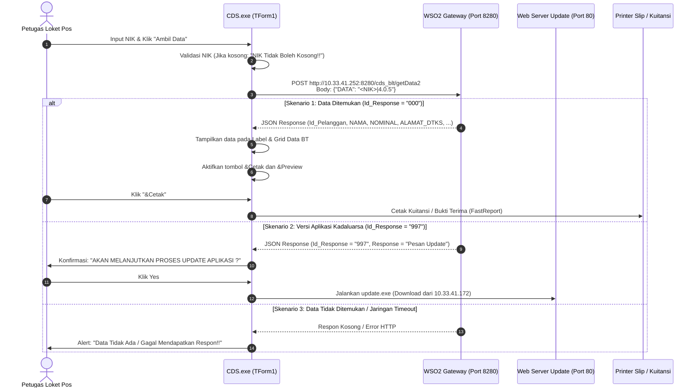

# 15. Analisis Biner Aplikasi CDS.exe & Strategi Penggantian Integrasi WSO2 ke Go API

Dokumen ini memuat laporan hasil *reverse engineering* teknis terhadap file biner **`CDS.exe`** (1,323,008 bytes, tanggal build 13 Maret 2025) yang berada di folder `/CDS`, penguraian protokol komunikasi ke **WSO2 Enterprise Integrator**, serta analisis kelayakan arsitektur untuk menggantikan ketergantungan tersebut ke **Go API** modern.

---

## 1. Ringkasan Eksekutif & Identitas File Biner

Aplikasi `CDS.exe` adalah utilitas mandiri (*standalone counter utility*) milik PT Pos Indonesia bernama **"Cetak Danom Satuan"** (CDS). Aplikasi ini digunakan oleh petugas loket pos untuk melakukan pencarian data penerima bantuan (*on-demand single lookup*) berdasarkan **NIK** dan mencetak kuitansi / bukti terima secara individual (misalnya pada penyaluran susulan BLT BBM, BSU / Bantuan Subsidi Upah, atau KPM yang datang di luar jadwal kelompok).

| Parameter Teknis | Keterangan Hasil Analisis |
| :--- | :--- |
| **Nama File & Ukuran** | `CDS.exe` (1,323,008 bytes / ~1.26 MB) |
| **Arsitektur PE** | PE32 i386 (Windows 32-bit x86 Executable) |
| **Kompiler** | Borland Delphi 7 |
| **Proteksi / Packer** | **ASPack 2.12** (`.aspack` VA: `0x541000`) |
| **Original Entry Point (OEP)**| **`0x006BF79C`** (Base: `0x400000` + RVA: `0x002BF79C`) |
| **Form Antarmuka Utama** | `TForm1` (Caption: `"Cetak Danom Satuan"`) |
| **Engine Pelaporan** | FastReport 4 / 6 (`TfrxReport`, `TfrxPreviewForm`, template cetak slip) |
| **Library Jaringan** | Indy 10 (`TIdHTTP`, `TIdCustomHTTP`) |
| **Integrasi Eksternal** | **WSO2 Enterprise Integrator HTTP Gateway** (Port 8280) |
| **Koneksi Database Lokal** | **TIDAK ADA** (100% *pure remote REST/HTTP lookup*) |
| **Updater Otomatis** | Terintegrasi dengan `update.exe` via HTTP web server internal |

---

## 2. Dekonstruksi Reverse Engineering CDS.exe

### 2.1 Unpacking ASPack & Ekstraksi Memori
Menggunakan teknik *dynamic debugger hook* pada instruksi `push OEP; ret` (alamat virtual `0x009413BA`), biner `CDS.exe` berhasil di-*unpack* secara penuh dari proteksi ASPack 2.12:
- **`CODE`**: 2,879,488 bytes (RVA `0x001000` &rarr; `0x2C0000`).
- **`DATA`**: 73,728 bytes (RVA `0x2C0000` &rarr; `0x2D2000`).
- **`RSRC`**: 2,326,528 bytes (RVA `0x309000` &rarr; `0x541000`).

### 2.2 Inventaris Form & Komponen Visual (`TForm1`)
Berdasarkan parsing resource formulir biner (`TPF0`), antarmuka utama `TForm1` berisi:
- **Input Field**:
  - `NIK` (`TEdit`, MaxLength: 16-20 karakter).
  - `Button1` (`TButton`, Caption: `"Ambil Data"`).
  - `Button2` (`TButton`, Caption: `"Reset"`).
- **Label Identitas KPM**:
  - `label_nama`, `Label_nik`, `Label_bsu` (Nominal bantuan), `label_noVoucher`, `label_nmPerusahaan`, `Label_alamatperusahaan`.
  - Hierarki wilayah: `label_header`, `label_prov`, `label_kab`, `label_kec`, `label_kel`.
- **Display & Pelaporan**:
  - `griddata_bt` (`TbvDBGrid`): Menampilkan baris data penerima yang ditarik dari server.
  - `btnCetakBT` (`TdxButton`, Caption: `"&Cetak"`): Mencetak kuitansi ke printer loket.
  - `btnPreviewBT` (`TdxButton`, Caption: `"&Preview"`): Menampilkan pratinjau dokumen FastReport.



---

## 3. Spesifikasi Kontrak Komunikasi WSO2 Gateway

Melalui disasembli prosedur penanganan klik tombol `Button1Click` pada alamat virtual `0x006BE5AC`, berikut kontrak teknis protokol komunikasi `CDS.exe`:

### 3.1 Endpoint & Header HTTP
- **URL Target**: `http://10.33.41.252:8280/cds_blt/getData2`
  *(Catatan: Port `8280` adalah port default HTTP Passthrough Transport pada WSO2 Enterprise Integrator / ESB)*.
- **HTTP Method**: `POST`
- **Request Headers**:
  ```http
  Content-Type: application/json
  Accept: */*
  User-Agent: Indy Library
  ```

### 3.2 Request Body Format
Payload JSON yang dikirimkan menggunakan format pembungkus pipa sederhana:
```json
{
  "DATA": "<NIK>|4.0.5"
}
```
*Keterangan*: 
- Segmen 1: Nilai NIK yang diinput petugas (16 digit angka).
- Segmen 2: Versi aplikasi `CDS.exe` yang di-hardcode (`"4.0.5"`).

### 3.3 Struktur Response JSON & Aturan Bisnis
Respon yang diterima dari WSO2 Gateway dievaluasi berdasarkan nilai properti `Id_Response`:

#### A. Respon Sukses (`Id_Response: "000"`)
```json
{
  "Id_Response": "000",
  "Response": "Success",
  "Id_Pelanggan": "320101XXXXXXXXXX",
  "NIK": "320101XXXXXXXXXX",
  "NAMA": "BUDI SANTOSO",
  "ALAMAT_DTKS": "JL. MAWAR NO. 12 RT 01 RW 02",
  "NMDESA_DTKS": "CIBINONG",
  "NMKEC_DTKS": "CIBINONG",
  "NMKAB_DTKS": "BOGOR",
  "NMPROP_DTKS": "JAWA BARAT",
  "KUANTITAS": "1",
  "NOMINAL": "600000",
  "HEADER_DANOM": "BANTUAN LANGSUNG TUNAI (BLT) BBM TAHAP 2"
}
```

#### B. Respon Update Versi (`Id_Response: "997"`)
Jika versi aplikasi pada payload request di bawah batas minimum yang ditetapkan server WSO2:
```json
{
  "Id_Response": "997",
  "Response": "Versi aplikasi Anda sudah kadaluarsa. Silakan lakukan pembaruan."
}
```
`CDS.exe` memunculkan pesan konfirmasi:
> *"AKAN MELANJUTKAN PROSES UPDATE APLIKASI ?"*

Jika pengguna menekan tombol `Yes`, aplikasi mengeksekusi biner `update.exe` dengan parameter baris perintah:
```cmd
update.exe "http://10.33.41.172/download/Param/UpdateEXE/v4.0.6/|CDS.exe|CDS.exe|"
```

---

## 4. Analisis Kelayakan: Penggantian WSO2 ke Go API

### 4.1 Jawaban Atas Pertanyaan User
> **"Apakah koneksi ke API WSO2 bisa digantikan ke Go API yang saat ini dibuat?"**

**JAWABAN: SANGAT BISA DAN SANGAT DIREKOMENDASIKAN.**

Menggantikan koneksi langsung dari desktop ke WSO2 dengan **Go API** menyelesaikan sejumlah kelemahan kritis yang ada pada arsitektur lama:

| Parameter Arsitektur | Kondisi Saat Ini (WSO2 Langsung dari `CDS.exe`) | Solusi Modern (Go API + Caddy) |
| :--- | :--- | :--- |
| **Alamat Jaringan** | **Hardcoded IP Privat**: `http://10.33.41.252:8280`. Jika IP server berubah, aplikasi *crash* total dan wajib re-deploy biner. | **Dynamic / Domain-based**: Klien mengarah ke nama domain internal terkelola (mis. `https://danom-api.posindonesia.co.id`) via Caddy. |
| **Keamanan Transport** | **Plaintext HTTP** tanpa enkripsi di jaringan WAN pos. Rentan *sniffing* data NIK dan nominal bantuan. | **TLS 1.3 / HTTPS**: Enkripsi *end-to-end* otomatis dikelola oleh Caddy Reverse Proxy. |
| **Autentikasi Klien** | **Tanpa Autentikasi**: Siapa pun di jaringan intranet pos dapat menembak endpoint port 8280 tanpa login. | **Stateless JWT**: Endpoint dilindungi token otorisasi petugas loket yang telah terotentikasi. |
| **Format Kontrak API** | Format semu *pipe-in-json*: `{"DATA": "NIK|4.0.5"}`. | **RESTful JSON Standard**: `POST /api/v1/cds-blt/data` dengan Request DTO terstruktur dan validasi skema. |
| **Konsolidasi Aplikasi** | Perlu 2 aplikasi terpisah: `ToolCetakDanom.exe` (batch) dan `CDS.exe` (satuan). | **Satu Klien Desktop Terpadu**: Fitur CDS Satuan disatukan sebagai tab / menu di aplikasi C# modern. |

---

### 4.2 Dua Opsi Strategi Implementasi pada Go API

Terdapat 2 opsi arsitektur bagaimana Go API menangani fungsionalitas CDS BLT:

```mermaid
flowchart TD
    subgraph Client Tier
        CS["C# WPF Client (CetakDanom.Desktop)"]
    end

    subgraph Edge & API Tier (Server)
        CAD["Caddy Reverse Proxy (Port 443 HTTPS)"]
        GO["Go API Middleware (/api/v1/cds-blt/data)"]
    end

    subgraph Enterprise Backend Tier
        DB[("MS SQL Server (Port 1433)\nSP: SIKAP_GET_DATA_BANSOSRS")]
        WSO2["WSO2 Gateway (Port 8280)\n/cds_blt/getData2"]
        KEMENSOS["Central DTKS / Kemensos Host"]
    end

    CS -->|HTTPS REST + JWT| CAD
    CAD -->|HTTP localhost:8080| GO
    
    GO -.->|Opsi B: Direct Query jika data ada di DB| DB
    GO -->|Opsi A: Proxy / Adapter Gateway| WSO2
    WSO2 --> KEMENSOS
```

#### Opsi A: Go API sebagai *Backend-For-Frontend (BFF)* / Proxy Adapter (Rekomendasi Utama)
Jika data penerima BLT satuan bersumber dari sistem terpusat di Kantor Pusat (Kemensos / SIKAP Pusat) yang hanya dapat diakses melalui WSO2 Enterprise Integrator:
1. Klien C# Desktop memanggil Go API melalui rute aman:
   `POST https://api.posindonesia.co.id/api/v1/cds-blt/data`
2. Go API memvalidasi JWT petugas dan format NIK (16 digit angka).
3. Go API bertindak sebagai *client* yang meneruskan panggilan ke WSO2 (`http://10.33.41.252:8280/cds_blt/getData2`) dengan timeout yang dapat dikonfigurasi pada file `.env` / `config.yaml`.
4. Go API menerima respon JSON WSO2, melakukan normalisasi DTO, dan mengembalikan data bersih ke C# Desktop.
5. **Keuntungan**: Klien C# tidak perlu tahu IP WSO2. Jika WSO2 di kemudian hari diganti dengan REST API Microservices Kemensos baru, **klien desktop tidak perlu diubah sama sekali**, cukup ubah adapter di Go API.

#### Opsi B: Go API Direct Database Query (Jika Data Tersedia Lokal)
Jika data KPM tersebut sudah tersedia di database MS SQL Server lokal/nasional:
1. Go API mengeksekusi Stored Procedure langsung:
   ```sql
   EXEC SIKAP_GET_DATA_BANSOSRS_BY_NIK @NIK = '320101XXXXXXXXXX'
   ```
2. Go API mengembalikan data langsung tanpa perlu melewati WSO2.
3. **Keuntungan**: Latensi jauh lebih cepat (<50ms vs ~800ms) dan mengurangi titik kegagalan (*single point of failure*).

---

## 5. Spesifikasi API Contract Go untuk CDS BLT

Fungsionalitas ini telah dipetakan pada dokumen kontrak API proyek. Berikut spesifikasi definitifnya:

### 5.1 Definisi Endpoint
- **URL**: `/api/v1/cds-blt/data`
- **Method**: `POST`
- **Authentication**: `Bearer <JWT_TOKEN>` (Role: Petugas Loket / Supervisor)

### 5.2 Request DTO
```json
{
  "nik": "3201012304850001",
  "client_version": "1.0.0"
}
```

### 5.3 Response DTO (200 OK)
```json
{
  "status_code": "000",
  "message": "Data KPM berhasil ditemukan",
  "data": {
    "id_pelanggan": "3201012304850001",
    "nik": "3201012304850001",
    "nama": "BUDI SANTOSO",
    "alamat": "JL. MAWAR NO. 12 RT 01 RW 02",
    "kelurahan": "CIBINONG",
    "kecamatan": "CIBINONG",
    "kabupaten": "BOGOR",
    "provinsi": "JAWA BARAT",
    "nominal": 600000,
    "kuantitas": 1,
    "program": "BLT BBM TAHAP 2",
    "header_danom": "DAFTAR NOMINATIF PENERIMA BLT BBM TAHAP 2"
  }
}
```

### 5.4 Error Responses
- **400 Bad Request**:
  ```json
  {
    "status_code": "400",
    "error": "NIK harus berupa 16 digit angka valid"
  }
  ```
- **404 Not Found**:
  ```json
  {
    "status_code": "404",
    "error": "Data penerima dengan NIK tersebut tidak ditemukan di sistem"
  }
  ```
- **502 Bad Gateway** (Jika WSO2 Pusat Timeout / Unreachable):
  ```json
  {
    "status_code": "502",
    "error": "Gagal terhubung ke Gateway Pusat WSO2. Silakan coba beberapa saat lagi."
  }
  ```

---

## 6. Kesimpulan & Rekomendasi Eksekusi

1. **Aplikasi `CDS.exe` Teridentifikasi Penuh**: `CDS.exe` adalah utilitas Delphi 7 *Cetak Danom Satuan* yang berfungsi tunggal untuk mencetak bukti terima KPM secara individual berbasis NIK melalui WSO2 Gateway `http://10.33.41.252:8280/cds_blt/getData2`.
2. **Koneksi WSO2 Pasti Bisa Digantikan oleh Go API**: Mengalihkan koneksi WSO2 ke Go API adalah langkah modernisasi yang sangat tepat dan aman. Go API akan bertindak sebagai *secure gateway adapter*, menyembunyikan IP internal WSO2 dari klien desktop dan membungkusnya dengan enkripsi HTTPS serta otentikasi JWT.
3. **Penyatuan ke Solusi Desktop C# WPF**: Pada implementasi Fase 2, kita tidak perlu memelihara file biner terpisah `CDS.exe` dan modul `update.exe`. Fungsionalitas pencarian satuan per-NIK ini cukup diimplementasikan sebagai menu/layar **"Cetak Danom Satuan"** di dalam aplikasi C# WPF `CetakDanom.Desktop` yang memanggil Go API `/api/v1/cds-blt/data`.
