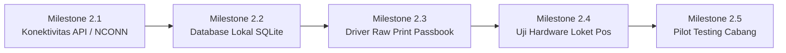

# Rekomendasi Tahap Lanjutan (Next Phase Recommendations) - Fase 2 & 3

Dokumen ini memuat rekomendasi teknis, analisis arsitektur, dan peta jalan (*roadmap*) transisi dari **Fase 1 Prototipe** menuju **Fase 2 Pengembangan Produksi** aplikasi CetakDanom Modern.

---

## 1. Keputusan Kritis Integrasi Middleware

Pada Fase 1, NCONN dan SQL Server sengaja diabstraksikan. Untuk Fase 2, terdapat dua jalur arsitektur middleware yang dapat dipilih:

### Opsi Rekomendasi Utama: Arsitektur REST API Modern (Go / ASP.NET Core + Caddy)
* **Kelebihan**:
  * Menghilangkan ketergantungan pada middleware lawas NCONN yang berumur 15+ tahun dan tidak memiliki dokumentasi resmi.
  * Menggunakan protokol standar industri HTTP/2 atau HTTP/3 dengan enkripsi TLS murni via Caddy Reverse Proxy.
  * Sangat ringan (dapat berjalan stabil di server Windows Server 2-Core / 4GB RAM).
  * Kontrak API telah selesai dirancang pada dokumen [api-contract.md](file:///d:/CetakDanom/docs/api-contract.md) dan [openapi.yaml](file:///d:/CetakDanom/docs/openapi.yaml).
* **Implementasi di Klien C#**: Cukup mengganti `MockDanomRepository` dengan `HttpDanomRepository` menggunakan `System.Net.Http.HttpClient` dan `System.Text.Json`.

### Opsi Alternatif: Pengemudi Protokol Biner 2P NCONN (Jika NCONN Wajib Dipertahankan)
* Jika manajemen PT Pos Indonesia melarang perubahan di sisi middleware/server, buat pustaka khusus C# `.NET 8` (`CetakDanom.NconnClient`) yang mengimplementasikan soket TCP biner (port 5000/6000) dan *framing* protokol 2P.

---

## 2. Modernisasi Penyimpanan Berkas Lokal (Pengganti File `.POS`)

Pada aplikasi Delphi lama, data Danom diunduh dan disimpan dalam bentuk berkas teks biner mentah `data/<file>.POS` yang tidak terenkripsi:
* **Kelemahan Delphi Lama**: Berkas `.POS` mudah dimanipulasi teksnya dengan Notepad, rentan korupsi jika listrik padam (*disk write corruption*), dan sering terkunci oleh antivirus saat prosedur `MoveFile` ke folder `sudah_cetak/`.
* **Rekomendasi Fase 2**:
  * Gunakan database lokal terenkripsi **SQLite dengan SQLCipher (256-bit AES)**.
  * Menggunakan library `Microsoft.Data.Sqlite`.
  * Seluruh data KPM tersimpan aman di disk lokal petugas loket, mendukung transaksi ACID (bebas korupsi data saat cetak terputus), dan pencarian instan berindeks.

---

## 3. Integrasi Perangkat Keras Printer Fisik (Passbook IBM &amp; Dot Matrix)

Pada Fase 1, pencetakan difokuskan pada pratinjau visual dan layout monospace. Pada Fase 2, implementasi pencetakan fisik langsung (*direct hardware printing*) harus diselesaikan:

1. **Pencetakan Kuitansi Passbook (IBM 9068A / Epson LQ-300)**:
   * **Wajib Gunakan P/Invoke WinSpool**: Jangan gunakan GDI grafis Windows karena jarum printer akan mencetak sangat lambat dan berisik.
   * Kirim perintah byte ESC/P mentah langsung ke printer melalui fungsi Windows API: `OpenPrinter`, `StartDocPrinter`, `WritePrinter`, `EndDocPrinter`, dan `ClosePrinter` di `winspool.drv`.
2. **Pencetakan Dokumen Danom (Lembar Fisik)**:
   * Gunakan pustaka **QuestPDF** atau **WPF FixedDocument** untuk menghasilkan dokumen PDF beresolusi tinggi dengan batas margin presisi sesuai standar kertas audit kantor pos.

---

## 4. Mekanisme Pembaruan Otomatis (*Auto-Updater*)

Menggantikan aplikasi terpisah `download.exe` / `update.exe` dengan teknologi modern:
* Gunakan **Velopack** (penerus Squirrel.Windows):
  * Pembaruan senyap di latar belakang (*silent delta updates*).
  * Tidak memerlukan hak akses administrator Windows saat melakukan update di loket pos.
  * Mendukung rollback otomatis jika versi baru mengalami crash saat startup.

---

## 5. Peta Jalan Implementasi Fase 2 (*Roadmap*)

| Fase | Target Deliverable | Estimasi Durasi |
| :--- | :--- | :---: |
| **Fase 2.1** | Implementasi `HttpDanomRepository` dan koneksi ke Go REST API / Caddy. | 2 Minggu |
| **Fase 2.2** | Implementasi database lokal SQLite terenkripsi pengganti `.POS`. | 1 Minggu |
| **Fase 2.3** | Implementasi modul WinSpool RAW Printing untuk printer passbook IBM 9068A. | 1.5 Minggu |
| **Fase 2.4** | Integrasi verifikasi NIK susulan (CDS BLT WSO2 Kemensos). | 1 Minggu |
| **Fase 2.5** | Uji coba fisik di loket kantor pos (*User Acceptance Test*). | 2 Minggu |
